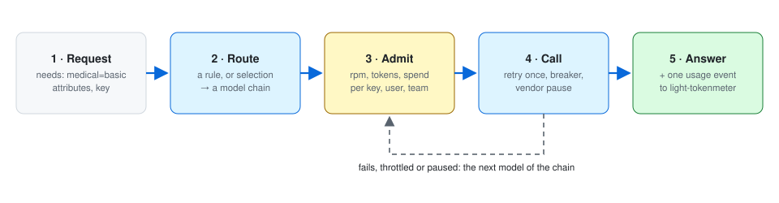
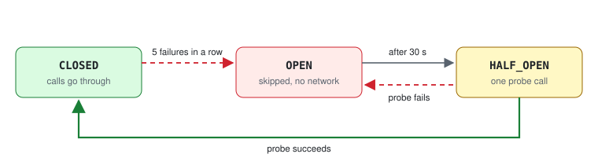

# Concepts

**The problem.** Code that names models ages with them: a new model means a redeploy, a vendor
outage means errors, and nothing stops one client from spending the month's budget in an hour.

**The approach.** A request says what it *needs*, models say what they are *good at*, and Keystone
picks an ordered chain of models for each call. On the way it checks limits, skips models that are
failing or throttled, and records one usage event per call. Everything about your product travels
in free-form attributes, so Keystone knows nothing about it.

<p align="center"></p>

**Contents:** [Glossary](#glossary) · [Needs and competencies](#needs-and-competencies) ·
[Limits](#limits) · [When a vendor fails](#when-a-vendor-fails) · [Usage reporting](#usage-reporting) ·
[Restricted data](#restricted-data) · [Semantic cache and latent guardrails](#semantic-cache-and-latent-guardrails)

## Glossary

| Term | Meaning |
| --- | --- |
| **Topic, level** | A subject such as `general`, `medical` or `legal`, and how well: `basic` < `proficient` < `expert`. |
| **Competencies** | What a model is good at: `{general: expert, medical: proficient}`. |
| **Needs** | What a request needs: `{medical: basic}`. |
| **Capabilities** | Technical abilities without a level: tools, vision, search, speech. |
| **Attributes** | The call's context (`user_id`, project, task) for rules and usage. |
| **Rule** | Matches needs and attributes, and gives an ordered model chain. |
| **Selection** | How Keystone builds the chain itself when no rule matches. |
| **Chain** | The models tried in order; each next one is a fallback. |
| **Excess** | Levels a model has above the request's needs, summed over the topics. |
| **Blended price** | `(3 × price_in + price_out) / 4` per million tokens. |
| **Circuit breaker** | Skips a `(vendor, model)` after repeated failures until a probe succeeds. |
| **Vendor pause** | Skips a model for a vendor key that answered `429`/`503` with `Retry-After`. |

## Needs and competencies

Both map a **topic** to a **level**. You pick the topics: lowercase words. Levels are ordered.

| Rule | Example |
| --- | --- |
| A model meets any need at its level or below. | `medical: proficient` serves `medical: basic`. |
| The code knows topics, not models. | A request sends `{medical: basic}`. |
| An unknown level is an error. | `INVALID_ARGUMENT` |
| An unknown topic is not an error. | No model has it; `ExplainRoute` shows that. |

**Effort is deprecated.** `LOW`, `MEDIUM` and `HIGH` are the needs `general: basic`, `proficient`
and `expert`, and requests may send them until 2.0. A model's `efforts` read as `general` at the
highest effort listed, and such a model keeps serving exactly the efforts it lists, so a 1.6
configuration routes as before.

### Rules come first

- A rule matches on needs (each of its topics at least at its level) and on attributes.
- A matching rule replaces the selection with its own chain. Canary weights and shadow traffic
  exist only in rules.
- A rule with needs also takes higher needs (`medical: basic` takes `medical: expert`). When no model
  of its chain meets such a request, the selection serves it.

### Selection without a rule

When no rule matches and some model declares competencies, Keystone builds the chain:

1. **Candidates:** enabled models that meet every need and the request's capabilities, have a vendor
   key, and are allowed by the key's and the team's `allowed_models`. A text call skips speech,
   image, judge, translate and embedding models.
2. **Order:**

   | By | Why |
   | --- | --- |
   | Placement class (`nodes_first` or `cloud_first`) | Price ranks only within a class, so free nodes do not take traffic from `cloud_first`. |
   | Excess, lowest first | An expert is not spent on a basic task. A model described by efforts counts at its highest effort. |
   | Blended price, lowest first | Translation ranks by `price_per_million_chars`; speech, images and judgments by their token prices. |
   | Model id | A stable tie-break. |

3. **Chain:** the first three. With nothing left the call gets `no_capable_model`.

Example: a request needs `{medical: basic}`, placement `cloud_first`.

| Model | Competencies | Excess | Blended price | Place |
| --- | --- | --- | --- | --- |
| `small-med` | `medical: basic` | 0 | $0.40 | 1 |
| `mid` | `general: proficient, medical: proficient` | 1 | $1.10 | 2 |
| `big` | `general: expert, medical: expert` | 2 | $6.00 | 3 |
| `general-only` | `general: expert` | — | — | not a candidate |

Configurations without competencies still need a catch-all rule for every effort, as in 1.6.

## Limits

| Limit | Scope | Set with | When it is hit |
| --- | --- | --- | --- |
| Requests per minute of a model | per client key and model; per user and model | model `rpm`; `SetUserRateLimit` (`*` for defaults) | The model is skipped; the chain moves on. |
| Requests and tokens per minute of a key | per client key, over all models | key `rpm_limit`, `tpm_limit` | `RESOURCE_EXHAUSTED throttled:key_rpm` / `throttled:key_tpm` with `RetryInfo` |
| Daily tokens of a model | per client key, per user | model `daily_tokens_per_key`, `daily_tokens_per_user` | The model is skipped. |
| Spend in USD | per key, user (day or month), team (month) | [Spend limits](configuration.md#5-spend-limits-optional) | The model is skipped; a cheaper one may still fit. |
| Node slots | per node | the node's slots and `queue_timeout_ms` | The next model in the chain. |

- **Rate limits** use GCRA in Redis with a burst (`rpm_burst`, default `rpm - 1`, which behaves like
  a fixed window; `< 0` turns burst off). Key and user limits are checked atomically.
- **Daily budgets** reset at UTC midnight. `budget_grace_margin` (default 5%, `< 0` off) lets the
  last call over the budget finish instead of failing mid-stream.
- **Spend limits** reserve the call's worst case atomically before it runs and settle to the real
  cost after.
- **Node slots.** A call waiting for a free slot polls with jitter up to `queue_timeout_ms`;
  interactive calls (not service keys) wait at most 250 ms to protect time to first token. Keystone
  predicts the wait from the queue (its own leases plus what the engine reports waiting) and the
  expected duration, and moves to the next model at once when the wait would exceed the timeout. A
  slot lease is renewed while the call runs, so a long generation never frees a slot still in use.
- When no model of the chain is available, the caller gets `RESOURCE_EXHAUSTED`.

## When a vendor fails

<p align="center"></p>

| Situation | What Keystone does |
| --- | --- |
| `429`, `5xx` or a transport error (reset, EOF on a reused connection) | Retries once on the same model, then the next model. A stream retries only before its first chunk. Vendor SDK retries are off, so one attempt is one vendor call. |
| The vendor says to wait ≤ 1 s (`Retry-After`, `retry-after-ms`, Gemini `RetryInfo`) | Waits in place, then the same-model retry. |
| It says to wait longer, on `429` or `503` | Pauses the model for that vendor key, up to `VENDOR_COOLDOWN_MAX`, and moves on. Clients sharing the vendor key share the pause. |
| `CIRCUIT_BREAKER_FAIL_THRESHOLD` (5) failures in a row of a `(vendor, model)` | Opens the circuit: the model is skipped with no network call. After `CIRCUIT_BREAKER_COOLDOWN` (30 s) one probe goes through. |
| The vendor stalls past `UPSTREAM_REQUEST_TIMEOUT` | Counts as a failure (the whole call for unary and media, the gap between chunks for streams) and moves on. |
| Every model of the chain is open or paused | `UNAVAILABLE vendors_unavailable`. When all were paused, `RetryInfo` (HTTP `Retry-After`) says when the soonest pause ends. |

- Failures that count for the breaker: 5xx, dropped connections, connect and TLS timeouts, and
  upstream timeouts. A caller that hangs up or runs out of its own deadline does not trip it.
- Bedrock throttling carries no wait: it is retried and falls back as usual.
- Pauses and breakers live in each replica's memory, so a replica learns of a pause from its own
  first rejected call. Metrics: `ktms_fallbacks_total{reason="cooldown"}`, `ktms_vendor_cooldowns_total`.
- Shadow traffic respects pauses but never starts one. Local node models are never paused: the
  node pool has its own admission.

## Usage reporting

With `USAGE_COLLECTOR_HOST` set, every call sends one event to a gRPC service that implements
[`usage-proto/usage/v1/usage.proto`](../usage-proto/usage/v1/usage.proto), such as light-tokenmeter.

| Field | Content |
| --- | --- |
| vendor, model, tokens, duration, status | What happened. |
| `action_id` | Your label for the call site. |
| project | The `usage_project` attribute, or the API key's name. |
| meta | The rule, your attributes, `effort` (the general need as `low`, `medium` or `high`) and from 1.7 `needs` as `topic=level,…` sorted, e.g. `general=basic,medical=proficient`. |

With light-tokenmeter's authentication on, give Keystone a `write` token in
`USAGE_COLLECTOR_TOKEN`. A refused token is logged as an error, and events are held and retried.

## Restricted data

`data_classification: restricted` keeps a call on your own nodes: no cloud vendor sees it, and when
the nodes fail there is no fallback to the cloud.

**Where to set it.** On a key or a team it holds for every call, whatever the request says:

```bash
ktms keys mint scribe --team clinic/notes --data-classification restricted
ktms keys policy set billing --data-classification restricted   # unrestricted lifts it
```

```yaml
organizations:
  - name: clinic
    teams:
      - name: notes
        data_classification: restricted   # every key of the team
```

For one call: `data_classification: restricted` in `GenerateTextRequest` or on
`/v1/chat/completions`, or the `X-KTMS-Data-Classification: restricted` header (gRPC metadata
`x-ktms-data-classification`), which also covers embeddings, judgments, speech and images.

- A request can add the restriction, not lift a key's or team's. A value other than `restricted`
  or empty is `INVALID_ARGUMENT`.
- `SetAPIKeyPolicy` and `UpdateTeam` keep the current value when the field is empty, so an older
  client cannot lift it by leaving it out. `unrestricted` lifts it, and so does removing the field
  from the configuration file.
- `ktms keys list` shows a key's restriction, or its team's as `restricted (team)`.

**What a restricted call does.**

| Area | Behaviour |
| --- | --- |
| Routing | As `placement: nodes_only`: only node models (`local`, `ollama`). None in the chain: `FAILED_PRECONDITION no_capable_model`; all fail: `UNAVAILABLE vendors_unavailable`. `cloud_only` is `INVALID_ARGUMENT`; a `model_override` of a cloud model is `FAILED_PRECONDITION`. |
| Judges | The auto-effort and shadow judges run only on nodes; without one, the default effort is used or the evaluation skipped. |
| Cache | Skipped, so its answer is never served to another key. |
| Embeddings, judgments, speech, images | `FAILED_PRECONDITION` without a node model. |
| Batches | Need a node model, or are refused. |
| Usage | The event's meta carries `data_classification: restricted`; callers cannot set it themselves. |

Nodes are models of vendor `local` (registered `ktms-node`s) and `ollama` (an endpoint you
configure: point it only at servers you run). The restriction does not cover what is sent outside
the model chain: `LATENT_ENCODER_URL` (latent guardrails and the semantic cache) and MCP servers.
Point the encoder at your own infrastructure.

## Semantic cache and latent guardrails

Both turn text into vectors with the encoder at `LATENT_ENCODER_URL` (a JEPA or any embedding
model behind an OpenAI-compatible `/v1/embeddings`). Without it, or when it fails, a local lexical
hash encoder is used; it folds case, homoglyphs, zero-width and spaced-out letters.

| Feature | What it does | Settings |
| --- | --- | --- |
| **Semantic cache** | After an exact-cache miss, an `enable_cache` request whose final user message (or `request_instruction`) is close to an earlier one gets its answer: `cached: true`, usage meta `cache_match=semantic` and `cache_similarity`. | `SEMANTIC_CACHE_*` |
| **Latent guardrails** | Scores each prompt against category centroids (injection, jailbreak, prompt leak, exfiltration); the nearest one past the threshold blocks or logs with `guardrail_violation: latent <category> intent detected`. | `GUARDRAILS_LATENT_*` |

- **What must match for a cache hit:** everything except the wording of that last message — key,
  config version, system prompt, history, tools, effort, attributes and every number in the message.
- **Never cached:** prompts with PII and responses with tool calls. With guardrails on, the message
  is screened before a near match is served. Vectors and responses are encrypted at rest.
- **An unreachable encoder** fails open after the regex checks have run.
- **Cost:** the local encoder runs in-process; measure it with
  `go test -bench . ./internal/latent ./internal/guardrails ./internal/cache`. A remote encoder adds
  its own latency, bounded by `LATENT_ENCODER_TIMEOUT`.
