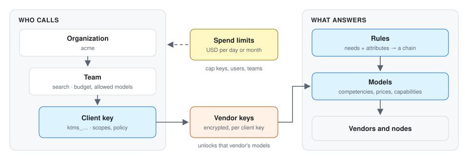

# Configuration

**The problem.** Who may call which models, with whose vendor keys, and up to how much money is
policy, and it changes more often than code. Policy spread over services and dashboards drifts.

**The approach.** All of it lives in Keystone: client keys with their policies, vendor keys, models,
rules, limits and tenants. You keep it as one YAML file in a repository and apply it like
Terraform, or change it at runtime with the CLI, the console or the Admin API. Every change is
validated against the whole configuration, so an invalid state never goes live. The process itself
is set up with environment variables.

<p align="center"></p>

**Contents:** [Glossary](#glossary) · [Configuration as a file](#configuration-as-a-file) ·
[API keys](#1-api-keys) · [Vendor keys](#2-vendor-keys-per-client) · [Models](#3-models) ·
[Rules](#4-rules) · [Spend limits](#5-spend-limits-optional) ·
[Organizations and teams](#6-organizations-and-teams-optional) ·
[Speech, image and judgment rules](#speech-image-and-judgment-rules) ·
[Rotating the encryption key](#rotating-the-encryption-key) ·
[Environment variables](#configuration-reference)

## Glossary

| Term | Meaning |
| --- | --- |
| **Client key** | `ktms_…`, what a service calls Keystone with. Has scopes and an optional policy. Only its hash is stored. |
| **Scope** | What a key may do: `generate`, `mcp`, `admin`, `admin:read`, `agents:read`. |
| **Policy** | A key's own limits: allowed models and MCP tools, `rpm_limit`, `tpm_limit`, data classification. |
| **Vendor key** | A provider's API key, encrypted and assigned to one client key. |
| **Model** | A vendor model registered with its competencies, capabilities, prices and limits. |
| **Rule** | Needs and attributes → an ordered model chain. The highest priority match wins. |
| **Spend limit** | A cap in USD per key or user per UTC day or month; a team has a monthly budget. |
| **Organization, team** | Tenants that keys belong to; a team narrows models and caps spend for all its keys. |
| **Keyring** | `KTMS_ENCRYPTION_KEYS`, the versioned keys that encrypt vendor keys. |

## Configuration as a file

The quickest way to see the whole configuration is to export it, edit it and plan the change:

```bash
export KTMS_ADDR=localhost:9090 KTMS_ADMIN_KEY=ktms_...   # admin; admin:read is enough for plan and export
ktms config export -o ktms.yaml      # start from what is running
ktms config plan -f ktms.yaml        # what would change; --detailed-exitcode exits 3 on drift
ktms config apply -f ktms.yaml       # asks before applying; --yes for scripts
```

```yaml
# yaml-language-server: $schema=https://raw.githubusercontent.com/ai-process/ktms/main/schema/ktms-config.schema.json
api_version: ktms.ai-process.dev/v1alpha1
models:
  - {id: gpt-4o-mini, vendor: openai, competencies: {general: proficient},
     price_in_per_mtok: 0.15, price_out_per_mtok: 0.6, price_cache_read_per_mtok: 0.075}
rules:
  - {name: default, priority: 1, use: [gpt-4o-mini]}
organizations:
  - name: acme
    teams: [{name: search, monthly_budget_usd: 100, allowed_models: [gpt-4o-mini]}]
api_keys:
  - {name: billing, policy: {rpm_limit: 120, tpm_limit: 200000}}
  - {name: search-bot, organization: acme, team: search}
vendor_keys:
  - {api_key_name: billing, vendor: openai, plain_key_env: OPENAI_KEY_BILLING}
spend_limits:
  - {subject_type: key, subject_id: billing, period: day, limit_usd: 5}
user_rate_limits:
  - {user_id: "*", model_id: gpt-4o-mini, rpm: 30}
```

| Section | Holds |
| --- | --- |
| `models`, `rules`, `user_rate_limits` | The Admin API's own messages (`ModelSpec`, `RuleSpec`, …) with the same field names. Without `enabled`, a model or rule is enabled. |
| `api_keys` | Keys, their scopes, team and policy. |
| `vendor_keys` | Which client key holds which vendor's key, read from the variable in `plain_key_env`. |
| `organizations` | Organizations and their teams. |
| `spend_limits` | Key and user caps; a team's cap is its `monthly_budget_usd`. |
| `mcp_servers`, `mcp_credentials` | The [MCP gateway](mcp.md#mcp-gateway); credentials read from `value_env`. |
| `node_schedules` | Schedules Keystone sends to nodes that take theirs from it (`node_id`, `schedule` as text). Temporary overrides are not configuration. |

How apply works:

- **Only sections in the file are managed.** A missing section is left alone. `--prune` deletes what
  a managed section does not list, except `admin` and `admin:read` keys, which it only reports.
- **Secrets never go in the file.** A vendor key is compared with the stored one by fingerprint
  (`VendorKeyInfo.fingerprint`). Exported vendor keys point at `KTMS_VENDOR_KEY_<KEY>_<VENDOR>`,
  MCP credentials at `KTMS_MCP_CREDENTIAL_<SERVER>`. A new client key is printed once, after apply.
- **What the Admin API cannot change is refused before anything is applied:** a key's scopes or
  team, or a revoked key named again. Mint a key under another name instead.
- **Order:** organizations, models, keys, vendor keys, rules, limits, then deletes. If a step fails,
  the earlier ones stay applied; plan again to see what is left.
- The JSON Schema is [`schema/ktms-config.schema.json`](../schema/ktms-config.schema.json) (also
  `ktms config schema`); a full example is [`schema/example.yaml`](../schema/example.yaml).

## Setting it up: keys, models, rules

Each part below can be set in the file, with the [`ktms` command](console-and-cli.md#command-line-tool),
in the [web console](console-and-cli.md#web-console), or with the Admin API (`AdminService`, a key
with the `admin` scope). The Admin API calls are folded under each part.

### 1. API keys

```bash
ktms keys mint billing-service                       # scope generate; the key is printed once
ktms keys mint ops --scopes admin:read
ktms keys policy set billing-service --allowed-models gpt-4o-mini --rpm 120 --tpm 200000
ktms keys list; ktms keys revoke billing-service
```

Keys look like `ktms_<hex>`; keys minted before the rename start with `llm_` and keep working.

| Scope | Allows |
| --- | --- |
| `generate` | The data plane: generation, embeddings, speech, images, judgments. |
| `mcp` | The [MCP gateway](mcp.md#mcp-gateway). |
| `admin` | Everything. |
| `admin:read` | Admin API reads: `GetConfig`, `GetSpend`, `GetTeam`, `GetTeamSpend`, `ExplainRoute` and every `List*`. Sees every tenant, so it cannot belong to an organization or team. `GetConfig` shows vendor keys only by fingerprint. |
| `agents:read` | The [agents](mcp.md#agents)' cards and conversations: `ListAgents`, `ListAgentTasks`, `GetAgentTask`. |

A key's **policy** comes on top of its team's limits and each model's `rpm`. `SetAPIKeyPolicy`
replaces it, and the key's next call uses it.

| Policy field | Meaning |
| --- | --- |
| `allowed_models` | Models the key may call; empty allows any. A chain keeps only models both the key's and the team's lists allow; an override outside them, or a chain with none left, is `PERMISSION_DENIED` (the message names `key` or `team`). |
| `allowed_mcp` | MCP servers and tools a key with the `mcp` scope may use; see [MCP gateway](mcp.md#mcp-gateway). |
| `rpm_limit` | Calls per minute over all models, with a minute of them as burst. |
| `tpm_limit` | Tokens per minute over all models (GCRA weighted by tokens). A call books its input estimate when admitted and its real input + output when it ends, so an underestimate is paid by the next calls. A call larger than a minute of tokens never fits: `FAILED_PRECONDITION request_too_large` (HTTP 400). A cache hit counts as a call with no tokens. |
| `data_classification` | `restricted` keeps every call of the key on your own nodes; see [Restricted data](concepts.md#restricted-data). |

- Both rates count text, embeddings, judgments, speech and images (media by their real tokens
  only), not batches.
- Refusals: `RESOURCE_EXHAUSTED throttled:key_rpm` or `throttled:key_tpm` with `RetryInfo` (HTTP 429
  with `Retry-After`). Like every limit they need Redis and fail open without it.

<details>
<summary>Admin API</summary>

```bash
grpcurl -plaintext -H "authorization: Bearer $ADMIN_KEY" \
  -d '{"name":"billing-service","scopes":["generate"]}' \
  localhost:9090 ktms.v1.AdminService/MintAPIKey

grpcurl -plaintext -H "authorization: Bearer $ADMIN_KEY" \
  -d '{"name":"billing-service","policy":{"allowed_models":["gpt-4o-mini"],"rpm_limit":120,"tpm_limit":200000}}' \
  localhost:9090 ktms.v1.AdminService/SetAPIKeyPolicy
```

A policy can also be given at minting (`"policy": {...}`). `ListAPIKeys` and `RevokeAPIKey` do what
they say.

</details>

### 2. Vendor keys (per client)

```bash
echo "$GOOGLE_KEY" | ktms vendor-keys set billing-service google   # read from stdin, never echoed
ktms vendor-keys list
```

- A vendor key belongs to **one** client key and is encrypted at rest.
- A client can call only models of vendors it holds a key for; `ListModels` reflects that.
- The exception is `local`: models on registered nodes need no vendor key, so every client can call them.

| Vendor | API | Endpoint | Notes |
| --- | --- | --- | --- |
| `openai` | OpenAI | default | |
| `anthropic` | Anthropic | default | |
| `google` | Gemini | default | |
| `deepseek` | OpenAI-compatible | `https://api.deepseek.com` | |
| `groq` | OpenAI-compatible | `https://api.groq.com/openai/v1` | |
| `mistral` | OpenAI-compatible | `https://api.mistral.ai/v1` | |
| `azure` | Azure OpenAI Service | required: `https://<resource>.openai.azure.com`, optional `?api-version=...` | The model id is the deployment name. A content filter hit moves to the next model. |
| `bedrock` | Amazon Bedrock Converse / ConverseStream | optional override | Key: `<access_key_id>:<secret_access_key>[:<region>[:<session_token>]]`, region `us-east-1` by default. The model id is a foundation model or inference profile ARN/ID. Content filters and guardrail interventions move to the next model. |
| `ollama` | Any self-hosted OpenAI-compatible server (Ollama, llama.cpp) | required on the model, e.g. `https://host/v1` | The vendor key is the server's own. |
| `typesafe` | TypeSafe | default | Judgments only. |

<details>
<summary>Admin API</summary>

```bash
grpcurl -plaintext -H "authorization: Bearer $ADMIN_KEY" \
  -d '{"api_key_name":"billing-service","vendor":"google","plain_key":"AIza..."}' \
  localhost:9090 ktms.v1.AdminService/SetVendorKey
```

`DeleteVendorKey` removes one.

</details>

### 3. Models

```yaml
models:
  - id: gemini-2.5-flash            # referenced by rules and model_override; also sent to the vendor
    vendor: google
    competencies: {general: proficient, legal: basic}
    capabilities: [google_search]
    rpm: 600
    price_in_per_mtok: 0.30
    price_out_per_mtok: 2.50
    price_cache_read_per_mtok: 0.075
    daily_tokens_per_user: 500000
```

| Field | Meaning |
| --- | --- |
| `id` | Referenced by rules and `model_override`, and sent to the vendor. |
| `vendor` | One of the [vendors](#2-vendor-keys-per-client), or `local` for nodes. |
| `endpoint` | Optional base-URL override (Azure, self-hosted gateways…). |
| `competencies` | Topic → `basic`, `proficient` or `expert`; see [Needs and competencies](concepts.md#needs-and-competencies). Replaces the deprecated `efforts`. A model needs one of the two. |
| `capabilities` | See the table below. |
| `rpm` | Calls per client key per minute; `0` is unlimited. |
| `price_in_per_mtok`, `price_out_per_mtok` | USD per million tokens, for usage and spend limits. |
| `price_in_peak_per_mtok`, `price_out_peak_per_mtok` | For vendors with peak-hour pricing; else `0`. |
| `price_in_batch_per_mtok`, `price_out_batch_per_mtok` | Batch prices; `0` is half the normal price. |
| `price_cache_read_per_mtok`, `price_cache_write_per_mtok` | Prompt cache prices; `0` is the vendor default (below). |
| `daily_tokens_per_key` | Tokens per client key per UTC day; `0` is unlimited. |
| `daily_tokens_per_user` | Tokens per `attributes["user_id"]` (or `svc:<key_name>`) per UTC day. |
| `languages` | Required on translate models: `{source: [...], target: [...]}`, `"*"` for any. |
| `price_per_million_chars` | Translate: per million source characters, added to the token price. |
| `enabled` | Off takes the model out of routing. |

A model with only `efforts: [EFFORT_LOW, EFFORT_MEDIUM]` reads as `general: proficient` and keeps
serving exactly low and medium; `ktms config plan` prints a `hint:` with the competencies to write
instead.

**Prompt caching.** Input read from or written to the vendor's prompt cache is priced at the cache
prices (standard rates; peak and batch calls scale them like input). At `0` the default never
undercharges:

| Vendor | Read | Write |
| --- | --- | --- |
| `anthropic` | 0.1× input | 1.25× input (the 5-minute cache) |
| `bedrock` | 0.25× input (Claude reads at 0.1×, Nova at 0.25×) | 1.25× input |
| others | 1× input | 1× input |

Set the read price for OpenAI, Gemini and DeepSeek models to get their discount; the seeded OpenAI
and Gemini models carry theirs. Keystone reads the cached part from each vendor
(`cache_read_input_tokens` and `cache_creation_input_tokens`, `prompt_tokens_details.cached_tokens`,
DeepSeek's `prompt_cache_hit_tokens`, Gemini's `cachedContentTokenCount`, Bedrock's
`cacheRead/WriteInputTokens`), bills spend limits by it, sends it to light-tokenmeter as
`cache_read_tokens` and `cache_write_tokens`, and returns it in `TokensUsage.cache_read` /
`cache_write` and, over HTTP, `usage.prompt_tokens_details.cached_tokens`.

**Capabilities.**

| Capability | Meaning |
| --- | --- |
| `batch` | Can serve asynchronous batch text generation requests (`SubmitBatch`). |
| `google_search` | Can serve requests with `enable_google_search`. |
| `no_thinking` | The model reasons by default and bills the reasoning as output (DeepSeek V4, Gemma 4 on Ollama). The proxy turns it off: `thinking: {"type": "disabled"}` for DeepSeek, `reasoning_effort: "none"` for Ollama, and for `local` models when the serving node runs Ollama (other engines get no switch). OpenAI-compatible vendors only. |
| `no_sampling` | The model's API rejects sampling fields Keystone would otherwise send it (see [Sampling](grpc-api.md#sampling)): it gets none of `temperature`, `top_p`, `stop` and `seed`, and responses report them as ignored. |
| `sampling` | The model takes its vendor's sampling fields although its id says otherwise (see [Sampling](grpc-api.md#sampling)): an Azure deployment name, a Claude alias, a reasoning model run without reasoning. |
| `prompt_cache` | Anthropic only: puts `cache_control` breakpoints after the tools, the system prompt and, in a multi-turn conversation, the latest turn, so repeated prefixes are read at 0.1x input. A new prefix is written at 1.25x, so set it on models whose instructions or conversations repeat. |
| `vision` | Can process image parts in multimodal messages (`ImagePart`). |
| `audio_input` | Can process audio parts in multimodal messages (`AudioPart`). |
| `pdf_input` | Can process PDF document parts in multimodal messages (`DocumentPart`). |
| `tts` | Can serve `SynthesizeSpeech`. |
| `image` | Can serve `GenerateImage`. |
| `judge` | Can serve `Judge` (TypeSafe `jev-latest`, OpenAI `gpt-6-luna`). |
| `translate` | Can serve `Translate`: a chat model by prompt, a node MT model natively. Declares `languages` (see [Translation](grpc-api.md#translation)). |
| `embedding_input` | A judge model that scores raw latent vectors in `JudgeRequest.state_media` (`EmbeddingPart`). |
| `box` | A judge model that answers `JUDGE_TYPE_BOX`: where an object is on an image (TypeSafe `jev-1.14.0`; declare `vision` with it). Experimental. |

<details>
<summary>Admin API</summary>

Send the model to `UpsertModel`, as JSON with the field names above:

```bash
grpcurl -plaintext -H "authorization: Bearer $ADMIN_KEY" -d '{"model":{"id":"gemini-2.5-flash",
  "vendor":"google","competencies":{"general":"proficient","legal":"basic"},
  "capabilities":["google_search"],"rpm":600,"price_in_per_mtok":0.30,"price_out_per_mtok":2.50,
  "enabled":true}}' localhost:9090 ktms.v1.AdminService/UpsertModel
```

</details>

### 4. Rules

```yaml
rules:
  - {name: legal-review, priority: 30, needs: {legal: proficient}, attributes: {language: es},
     use: [gemini-2.5-pro, gpt-4o]}
  - {name: cheap-first, priority: 20, needs: {general: basic}, use: [deepseek-chat, gpt-4o-mini]}
  - {name: anything-else, priority: 1, use: [gpt-4o-mini]}
```

How a rule is chosen:

1. Rules are tried from the **highest priority** down; priorities and names are unique.
2. A rule matches when the request needs each topic of the rule's `needs` at least at that level
   (`legal: proficient` takes `legal: expert` too) **and** every rule attribute equals the request's.
   The deprecated `effort` still matches the general need exactly (unspecified = any).
3. The first match gives its chain, filtered to the models that meet all of the request's needs.
4. No match: once a model declares competencies, [selection](concepts.md#needs-and-competencies)
   builds the chain, and rules are optional. Without competencies, validation requires a
   **catch-all** (no attributes, no needs) for every effort, so no request falls through;
   `anything-else` above covers all three.

| Field | Meaning |
| --- | --- |
| `use` | The ordered **fallback chain**, cheaper first by convention. A throttled or unavailable model moves to the next. |
| `needs`, `attributes` | What the rule matches. A rule with `needs` must have a model in its chain that meets them. |
| `weights` | Canary or A/B: one positive integer per model in `use`, e.g. `[90, 10]`. Sticky per `canary_key` or `user_id` attribute (salted per rule name); otherwise, or with `canary_mode: "random"`, weighted random. Without `weights`, 100% goes to `use[0]`. |
| `shadow_model`, `shadow_percentage` | Mirrors 0–100% of the rule's traffic to a candidate model in the background. No effect on the caller's latency or answer. |
| `shadow_eval` | With `shadow_model`: a judge compares primary and shadow answers in the background (`primary`, `shadow` or `tie`, and quality scores), exported as `ktms_shadow_judge_evaluations_total` and `ktms_shadow_judge_scores`. |
| `enabled` | Off skips the rule. |

**Shadow calls** are not billed to end users (0 nano-USD in usage events), carry `is_shadow: "true"`
and `shadow: "true"`, do not count against the caller's spend limits or token budgets, respect model
RPM and global concurrency limits (512 shadow calls, 256 evaluations), and never trip circuit
breakers for primary traffic. Evaluations respect the judge model's RPM and circuit breaker without
spending the caller's limits.

`ReplaceRules` swaps the whole set atomically; there is no per-rule change. `GetConfig` shows the live set.

<details>
<summary>Admin API</summary>

```bash
grpcurl -plaintext -H "authorization: Bearer $ADMIN_KEY" -d '{"rules":[
  {"name":"legal-review", "priority":30, "needs":{"legal":"proficient"},
   "attributes":{"language":"es"}, "use":["gemini-2.5-pro","gpt-4o"], "enabled":true},
  {"name":"cheap-first",  "priority":20, "needs":{"general":"basic"},
   "use":["deepseek-chat","gpt-4o-mini"], "enabled":true},
  {"name":"anything-else", "priority":1,
   "use":["gpt-4o-mini"], "enabled":true}
]}' localhost:9090 ktms.v1.AdminService/ReplaceRules
```

</details>

### 5. Spend limits (optional)

Hard caps in USD across all models, kept in nano-USD (1 USD = 1 000 000 000) to avoid float drift.
Calls are priced from the model's prices, peak and batch rates included.

```bash
ktms limits set key support-bot day 50      # $50 a day for the key support-bot
ktms limits set user '*' month 20           # $20 a month for every end user by default
ktms spend get key support-bot              # where it stands now
```

| Field | Values |
| --- | --- |
| `subject_type` | `key` (the API key name) or `user` (`attributes["user_id"]`, or `svc:<key_name>`). |
| `subject_id` | A name, or `*` as the default for every subject of that type. |
| `period` | UTC `day` or `month`. |

How a cap works:

- **Before each model of the chain is called,** its worst case is reserved atomically on every
  counter that applies, by one Redis Lua script: estimated input × the dearer of the input and
  cache-write price, plus max tokens × the output price (or `SPEND_DEFAULT_OUTPUT_RESERVE_TOKENS`
  without max tokens). When the call ends, the reservation is settled to the actual cost.
- **A call that would cross a cap is refused,** so a cheaper model further down the chain may still
  be tried.
- **Batches** are checked at submission (refused once a cap is reached) and charged at the batch
  rate when results arrive.
- **Refusals:** `RESOURCE_EXHAUSTED throttled:spend_key_daily`, `throttled:spend_key_monthly`,
  `throttled:spend_user_daily` or `throttled:spend_user_monthly`, with `RetryInfo` until the period
  resets (HTTP 429 `insufficient_quota` with `Retry-After`).
- **Seeing caps:** `ListSpendLimits`, `DeleteSpendLimit` and `GetConfig`. Every usage event carries
  `cost_nanousd`, which light-tokenmeter sums per day, model, user or job.
- **Seeing spend:** `GetSpend` reads the counters that refuse calls, for a key, user or team: one
  window per period with `spent_nanousd`, `limit_nanousd`, `remaining_nanousd` and `resets_at`.
  Spend is counted only under a cap (a `*` limit counts for every subject): an uncapped window says
  `metered: false`, and a cap set mid-period counts from then on. A new cap shows at once on the
  replica that set it, within `ROUTING_RELOAD_SECONDS` on the others.

<details>
<summary>Admin API</summary>

```bash
grpcurl -plaintext -H "authorization: Bearer $ADMIN_KEY" -d '{"spend_limit":
  {"subject_type":"key","subject_id":"support-bot","period":"day","limit_nanousd":50000000000}}' \
  localhost:9090 ktms.v1.AdminService/SetSpendLimit

grpcurl -plaintext -H "authorization: Bearer $ADMIN_KEY" -d '{"spend_limit":
  {"subject_type":"user","subject_id":"*","period":"month","limit_nanousd":20000000000}}' \
  localhost:9090 ktms.v1.AdminService/SetSpendLimit
```

`GetSpend` takes `{"subject_type":"key","subject_id":"billing-service"}`.

</details>

### 6. Organizations and teams (optional)

Group keys into organizations and teams to give each team its own models and monthly budget:

```yaml
organizations:
  - name: acme
    teams:
      - {name: search, monthly_budget_usd: 500, allowed_models: [gpt-5.1, local-qwen3-32b]}
api_keys:
  - {name: search-service, scopes: [generate], organization: acme, team: search}
```

| Team field | Meaning |
| --- | --- |
| `allowed_models` | A team key may call only these (empty means any). An override outside them is `PERMISSION_DENIED`; a chain is filtered to them, and one with none left is `PERMISSION_DENIED`. `ListModels` and `/v1/models` list only these. Keystone's own judge calls (auto effort, shadow evaluation) are not restricted. |
| `monthly_budget_usd` | A spend limit on all the team's keys together, per UTC month: `RESOURCE_EXHAUSTED throttled:spend_team_monthly`. Set only through `CreateTeam`/`UpdateTeam` (`0` lifts it); `SetSpendLimit` refuses `subject_type: "team"`. `GetTeamSpend` reads the counter, which runs only while a budget is set. |
| `data_classification` | `restricted` keeps every call of the team's keys on your own nodes; see [Restricted data](concepts.md#restricted-data). |
| `allowed_mcp` | MCP servers and tools for the team's keys; see [MCP gateway](mcp.md#mcp-gateway). |

- `UpdateTeam` replaces the team: send every field, since an omitted budget or model list lifts the
  cap or the restriction.
- Rules can match `org_id` and `team_id`. Keystone sets them from the key; callers cannot.
- Deleting a team or organization detaches revoked keys and is `FAILED_PRECONDITION` while active
  keys remain: revoke or move them first.

<details>
<summary>Admin API</summary>

```bash
grpcurl -plaintext -H "authorization: Bearer $ADMIN_KEY" -d '{"name":"acme"}' \
  localhost:9090 ktms.v1.AdminService/CreateOrganization
grpcurl -plaintext -H "authorization: Bearer $ADMIN_KEY" -d '{"org_id":"<org id>","name":"search",
  "monthly_budget_usd":500,"allowed_models":["gpt-5.1","local-qwen3-32b"]}' \
  localhost:9090 ktms.v1.AdminService/CreateTeam
grpcurl -plaintext -H "authorization: Bearer $ADMIN_KEY" -d '{"name":"search-service",
  "scopes":["generate"],"org_id":"<org id>","team_id":"<team id>"}' \
  localhost:9090 ktms.v1.AdminService/MintAPIKey
```

</details>

### Speech, image and judgment rules

Speech, images, judgments and translation route by a reserved `attributes["modality"]`: `tts`,
`image`, `judge` or `translate`.

- Only rules that name that modality match, over models that declare the matching capability.
- They may state `needs`; without them only the modality filters (and, for translation, the language
  pair). A model described by efforts serves them only if it lists `EFFORT_LOW`, as in 1.6.
- Without such a rule, and with competencies declared, selection picks among the models with that
  capability. Otherwise the call fails with `FAILED_PRECONDITION no_capable_model`.

```yaml
rules:
  - {name: speech, priority: 100, attributes: {modality: tts}, use: [gemini-2.5-flash-preview-tts]}
```

### Rotating the encryption key

New writes use the highest version in `KTMS_ENCRYPTION_KEYS`; every listed version can decrypt.

1. **Add a new version and deploy it to every replica:** `1:<old>,2:<new>`. Until all replicas run
   it, do not add or change vendor keys (or the `SEED_*_KEY` values with `AUTO_SEED`): a replica
   still on `1:<old>` cannot read a key written with version 2.
   - Such a replica logs an error, counts `ktms_dependency_errors_total{dependency="keyring"}` and
     keeps the credential it already had for that client and vendor.
   - A replica that starts in that state has none, so that client's calls skip that vendor's models
     (the next model serves, or `no_vendor_key`). The rest of the config keeps loading.
   - A keyring that can read no vendor key at all is refused at startup: that is a wrong keyring,
     not a rotation.
2. **Call `RotateEncryption` once** (`ktms rotate-encryption`), on any replica. It re-encrypts every
   vendor key and the auth tokens of registered nodes with version 2, in one transaction that locks
   the rows it rewrites, and returns how many it changed; a second call changes nothing. If a
   vendor key needs a version the keyring lacks, it fails with `FAILED_PRECONDITION` naming the key
   and changes nothing.
3. **Remove version 1 and redeploy,** but only when no database backup you may restore still holds
   keys encrypted with it (see [Backups](operations.md#backups-and-the-encryption-keyring)). Until
   then, leaving it listed is harmless. Cached responses encrypted with a removed version are
   treated as misses.

`TestRotateEncryptionLetsTheOldKeyGo` runs this sequence against Postgres in CI.

## Configuration reference

Every setting of the process is an environment variable; see [`env.example`](../env.example).

### Required

Without these Keystone does not start.

| Variable | Default | Description |
| --- | --- | --- |
| `DATABASE_URL` | – | **Required.** Postgres connection string. |
| `KTMS_ENCRYPTION_KEYS` / `LLMPROXY_ENCRYPTION_KEYS` | – | **Required.** Versioned keyring `1:<base64 32 bytes>[,2:…]`. The highest version encrypts new writes; all listed versions can decrypt. |

### Listeners and process

Ports, timeouts and logging.

| Variable | Default | Description |
| --- | --- | --- |
| `GRPC_ADDR` | `:9090` | gRPC listen address (data and admin planes). |
| `GRPC_MAX_RECV_MSG_SIZE` | `16777216` | Maximum gRPC message receive size in bytes (16MB). |
| `HTTP_ADDR` | `:8080` | HTTP listen address (health probes and the OpenAI-compatible API). |
| `HTTP_API_ENABLED` | `true` | Serve the `/v1` API on `HTTP_ADDR`; `false` leaves only the health probes. |
| `HTTP_API_TIMEOUT` | `5m` | Read/write timeout for one HTTP API call (it waits on an upstream model). |
| `METRICS_ADDR` | `:9091` | Internal HTTP listen address for Prometheus `/metrics` and `/healthz`. Empty disables the metrics server. |
| `LOG_LEVEL` | `info` | zerolog level. |
| `SHUTDOWN_TIMEOUT` | `30s` | Graceful drain time on SIGTERM. |

### Postgres

The configuration store, key checks and migrations.

| Variable | Default | Description |
| --- | --- | --- |
| `DB_MAX_CONNS` / `DB_MIN_CONNS` | `25` / `5` | Postgres pool bounds. |
| `DB_TIMEOUT` | `3s` | Bounds connecting to Postgres (unless the DSN sets `connect_timeout`) and each per-request query such as key checks, so a hung database fails calls fast. |
| `AUTH_STALE_IF_ERROR` | `5m` | While Postgres is unreachable, a key that verified within this window keeps working (a revocation made just before the outage can lag by at most this much). `0` refuses every call during an outage. |
| `ROUTING_RELOAD_SECONDS` | `60` | How often replicas poll for config changed elsewhere. |
| `AUTO_MIGRATE` | `true` | Apply embedded migrations at startup (guarded by an advisory lock, safe for rolling deploys). Off means applying `migrations/*.sql` by hand. |
| `MIGRATE_TIMEOUT` | `3m` | Bound for the whole migration run. |

### First start

Seed data and the first admin key; unset them in production.

| Variable | Default | Description |
| --- | --- | --- |
| `BOOTSTRAP_ADMIN_KEY` | empty | Implicit admin key for creating the first real key. Unset afterwards. |
| `AUTO_SEED` | `false` | Automatically populate initial models, rules, and client key when starting against an unconfigured database (enabled in docker-compose). |
| `SEED_CLIENT_KEY` | empty | Pre-configured client API key (e.g. `ktms_dev_default_key`) for auto-seed; generated if unset. |
| `SEED_CLIENT_NAME` | `dev-default` | Name assigned to the auto-seeded client API key. |
| `SEED_OPENAI_KEY` / `OPENAI_API_KEY` | empty | OpenAI API key to encrypt and register during auto-seeding. |
| `SEED_GEMINI_KEY` / `GEMINI_API_KEY` | empty | Google Gemini API key to encrypt and register during auto-seeding. |
| `SEED_ANTHROPIC_KEY` / `ANTHROPIC_API_KEY` | empty | Anthropic API key to encrypt and register during auto-seeding. |

### Redis and limits

Without Redis no limit is enforced.

| Variable | Default | Description |
| --- | --- | --- |
| `REDIS_ADDR` | empty | Redis for throttling. Empty disables limits. |
| `REDIS_PASSWORD` / `REDIS_DB` | empty / `0` | Redis auth and database. |
| `REDIS_KEY_PREFIX` | empty | Namespace for counters when Redis is shared (compose uses `dev`). |
| `REDIS_TIMEOUT` | `500ms` | Per-command Redis read/write timeout (dials get twice as long, one retry). With the fail-fast guard, about what a hung Redis adds to a request before limits fail open. |
| `BUDGET_GRACE_MARGIN` | `0.05` | Fraction of daily token budget allowed as grace overdraft (0.05 = 5%, 0.0 or negative disables grace overdraft). |
| `SPEND_LIMITS_FAIL_MODE` | `open` | What spend limits do when Redis errors: `open` lets calls through unmetered (logged), `closed` refuses calls under a spend limit with `UNAVAILABLE throttled:spend_unavailable`. |
| `SPEND_DEFAULT_OUTPUT_RESERVE_TOKENS` | `4096` | Output tokens priced into a spend reservation when the call sets no max tokens. |

### When vendors fail

See [When a vendor fails](concepts.md#when-a-vendor-fails).

| Variable | Default | Description |
| --- | --- | --- |
| `CIRCUIT_BREAKER_ENABLED` | `true` | Enable upstream Circuit Breaker to fail-fast during provider outages without network IO. |
| `CIRCUIT_BREAKER_FAIL_THRESHOLD` | `5` | Consecutive upstream failures (5xx, network timeouts) before tripping circuit to Open. |
| `CIRCUIT_BREAKER_COOLDOWN` | `30s` | Cooldown period before allowing a single probe request in Half-Open state. |
| `UPSTREAM_REQUEST_TIMEOUT` | `0` (disabled) | Upstream vendor timeout (total per-attempt deadline for unary/media; per-chunk idle watchdog for streaming). Stalls trip breaker and advance fallback chains. |
| `VENDOR_COOLDOWN_MAX` | `5m` | Longest pause honoured when a vendor answers `429`/`503` with `Retry-After`. `0` disables pauses. |

### Batches

See [Batch text generation](grpc-api.md#batch-text-generation).

| Variable | Default | Description |
| --- | --- | --- |
| `BATCH_POLL_SECONDS` | `60` | Background polling interval in seconds for checking unfinished batch jobs. |
| `BATCH_MAX_ITEMS` | `10000` | Maximum number of items allowed in a single batch submission. |
| `RESULTS_RETENTION_DAYS` | `7` | Retention period for completed batch results before cleanup (accepts integer days, e.g. `7`, or Go duration string, e.g. `168h`). |

### Nodes

See [Nodes](nodes.md).

| Variable | Default | Description |
| --- | --- | --- |
| `NODE_HEARTBEAT_INTERVAL_SECONDS` | `5` | Node daemon heartbeat reporting interval in seconds. |
| `NODE_HEARTBEAT_TTL_SECONDS` | `15` | Heartbeat TTL in seconds before an idle node transitions to `OFFLINE`. |
| `NODE_RETENTION_TTL_DAYS` | `1` | Retention period in days for inactive/offline nodes before garbage collection. |
| `NODE_ALLOW_LOCALHOST_ENDPOINTS` | `false` | Allow loopback/link-local endpoints for local inference nodes (useful in tests/dev). |
| `NODE_USAGE_RETENTION_HOURS` | `168` | Hours each node's request log (time, model, tokens, outcome; no user, key or text) is kept in Redis (6.2+) for the node's daemon to pull with `PullNodeUsage`; a node with no requests for that long loses its log, and revoking its key deletes it. `0` turns the log off. |

### Usage reporting

See [Usage reporting](concepts.md#usage-reporting).

| Variable | Default | Description |
| --- | --- | --- |
| `USAGE_COLLECTOR_HOST` | empty | `host:port` of a gRPC usage sink. Empty disables reporting. |
| `USAGE_COLLECTOR_TLS` | `false` | Reach the sink over TLS, e.g. light-tokenmeter on Cloud Run (`host:443`). |
| `USAGE_COLLECTOR_TOKEN` | empty | Bearer token sent to the sink on every call; for light-tokenmeter, a token with the `write` scope. Empty sends none. |
| `USAGE_PROJECT_ID` | `ktms` | Default project name on usage events. |

### Errors and tracing

Sentry and OpenTelemetry.

| Variable | Default | Description |
| --- | --- | --- |
| `SENTRY_DSN` | empty | Error reporting; empty disables it. |
| `SENTRY_ENVIRONMENT` / `SENTRY_RELEASE` | `development` / empty | Sentry metadata. |
| `SENTRY_ENABLE_TRACING` | `false` | Sentry performance tracing. |
| `SENTRY_DEBUG` | `false` | Sentry SDK debug logging. |
| `SENTRY_WITH_BREADCRUMBS` | `false` | Attach recent log lines to Sentry events as breadcrumbs. |
| `OTEL_SERVICE_NAME` | `ktms` | Service name reported in OpenTelemetry traces. |
| `OTEL_EXPORTER_OTLP_ENDPOINT` | empty | OTLP gRPC endpoint (`host:port`) for distributed tracing; empty disables remote export. |

### Cache and guardrails

See [Semantic cache and latent guardrails](concepts.md#semantic-cache-and-latent-guardrails).

| Variable | Default | Description |
| --- | --- | --- |
| `CACHE_ENABLED` | `false` | Enable prompt and completion exact-match cache in Redis. |
| `CACHE_TTL` | `1h` | Expiration time for cached responses. |
| `CACHE_MAX_BYTES` | `1048576` | Maximum size in bytes of a single cached response (1MB). Responses exceeding this are not cached. |
| `GUARDRAILS_ENABLED` | `false` | Enable input/output security guardrails (PII masking and prompt injection detection). |
| `GUARDRAILS_PII_ACTION` | `block` | Action on detected PII: `block` (reject with `guardrail_violation`) or `redact` (mask with placeholders and desanitize in output). |
| `GUARDRAILS_PROMPT_INJECTION_ACTION` | `block` | Action on detected prompt injection: `block` or `log`. |
| `GUARDRAILS_LATENT_ENABLED` | `false` | Experimental. With `GUARDRAILS_ENABLED`, also screen prompts in latent space against injection, jailbreak, prompt-leak and exfiltration centroids (see [Latent guardrails](concepts.md#semantic-cache-and-latent-guardrails)). |
| `GUARDRAILS_LATENT_THRESHOLD` | `0.70` | Cosine similarity to a malicious centroid at which a prompt is flagged. Tuned for the local encoder; recalibrate for a JEPA encoder. |
| `GUARDRAILS_LATENT_ACTION` | `block` | `block` (reject with `guardrail_violation`) or `log`. |
| `GUARDRAILS_LATENT_CATEGORIES_FILE` | empty | JSON array of extra categories (`name`, `phrases`, and/or precomputed `centroids` of `{model, vector}`), added to the built-in set. |
| `SEMANTIC_CACHE_ENABLED` | `false` | Experimental. Serve `enable_cache` requests whose final user message is semantically close to a cached one. Needs Redis; uses `CACHE_TTL` and `CACHE_MAX_BYTES`. |
| `SEMANTIC_CACHE_SIMILARITY_THRESHOLD` | `0.95` | Minimum cosine similarity for a semantic hit. |
| `SEMANTIC_CACHE_MAX_ENTRIES` | `256` | Vectors kept (and scanned per lookup) for one exact context; older entries are trimmed. |
| `LATENT_ENCODER_URL` | empty | Experimental. OpenAI-compatible `/v1/embeddings` endpoint, e.g. a node serving a JEPA encoder. Empty uses the local hash encoder; failures fall back to it. |
| `LATENT_ENCODER_MODEL` | `jepa-text` | Model name sent to the encoder; also namespaces cached vectors. |
| `LATENT_ENCODER_API_KEY` | empty | Bearer token for the encoder, if it needs one. |
| `LATENT_ENCODER_TIMEOUT` | `50ms` | Bound for one encoder call before falling back to the local encoder. |
| `LATENT_LOCAL_ENCODER_DIMS` | `512` | Width of the local hash encoder's vectors. |
| `LATENT_ENCODER_CACHE_SIZE` | `4096` | In-memory LRU of recent embeddings, so guardrails and cache encode a prompt once. `0` disables it. |

### MCP gateway and agents

See [MCP gateway](mcp.md#mcp-gateway) and [Agents](mcp.md#agents).

| Variable | Default | Description |
| --- | --- | --- |
| `MCP_GATEWAY_ENABLED` | `true` | Serve the [MCP gateway](mcp.md#mcp-gateway) (`/mcp`, `/mcp/{server}`) on `HTTP_ADDR`. |
| `AGENTS_ENABLED` | `true` | Serve the [agents' inbox](mcp.md#agents), the gateway's built-in server `agents`. |
| `AGENTS_MAX_DEPTH` | `5` | How deep a chain of tasks in one conversation may go. |
| `AGENTS_MAX_MESSAGES_PER_CONTEXT` | `200` | Messages in one conversation. |
| `AGENTS_MAX_MESSAGE_BYTES` | `65536` | Size of one message, at most `1048576`. |
| `AGENTS_MAX_TASKS_PER_PAIR_HOUR` | `100` | Tasks one agent may send another within an hour, in any conversation; `0` is unlimited. |
| `AGENTS_TOOL_RPM` | `60` | Calls of each agents tool per key and minute; `0` is unlimited. Needs Redis. |
| `AGENTS_RETENTION` | `720h` | Tasks unchanged this long are deleted; `0` keeps them. |
| `AGENTS_CORRECTION_WINDOW` | `168h` | How long after its last change an ended task takes a correction of its answer. |
| `AGENTS_MAX_PINNED` | `200` | Tasks one agent may pin with `pin_task`; pinned tasks outlive `AGENTS_RETENTION`. |
| `AGENTS_RECORDING` | `metadata` | What the journal keeps by default: `off`, `metadata` or `full`. |
| `AGENTS_JOURNAL_MAXLEN` | `100000` | Events the journal's Redis stream keeps; the oldest go first. |
| `AGENTS_JOURNAL_MAX_EVENT_BYTES` | `16384` | Text of one `full` event; longer text is cut and hashed. |
| `AGENTS_JOURNAL_REDIS_URL` | – | A separate Redis for the journal (`redis://...`); empty uses `REDIS_ADDR`. |
