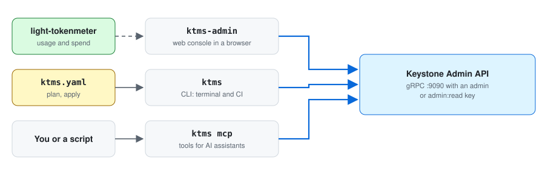

# Console, CLI and AI assistants

**The problem.** The Admin API is gRPC: fine for automation, tedious for a person who wants to add a
key, check spend or see why a call went where it did.

**The approach.** Three clients of the same Admin API, for three ways of working: a web console for
people, the `ktms` CLI for terminals and CI, and `ktms mcp` for AI assistants. All three use the same
keys and change the same configuration; the CLI and the assistant also keep it as a file.

<p align="center"></p>

**Contents:** [Glossary](#glossary) · [Web console](#web-console) · [Command-line tool](#command-line-tool) ·
[MCP server for AI assistants](#mcp-server-for-ai-assistants) ·
[Claude Code plugin and skills](#claude-code-plugin-and-skills)

## Glossary

| Term | Meaning |
| --- | --- |
| **Context** | A named Keystone (address, TLS, HTTP URL) and where its keys live, like a kubectl context. |
| **Key source** | `env:VAR`, `file:PATH` or `keychain`. |
| **Plan, apply** | Compare a configuration file with Keystone, then change Keystone to match it. |
| **Read tools, write tools** | What `ktms mcp` offers an assistant by default (reads), and with `--allow-write`. |
| **Skill** | A `SKILL.md` folder that teaches an assistant one task, such as deploying Keystone. |

## Web console

[**ktms-admin**](https://github.com/ai-process/ktms-admin) manages models, routing rules, client
keys and vendor credentials in a browser, has a playground for trying a prompt through your rules,
and, with [light-tokenmeter](https://github.com/ai-process/light-tokenmeter), shows usage and spend
per project, user and model.

| Sign-in | |
| --- | --- |
| Methods | A password, Google or any OpenID Connect provider, GitHub, or an access proxy (oauth2-proxy, Authelia, Cloudflare Access, …). |
| Who | An e-mail allowlist with wildcards (`*@example.com`). |

**Run it:**

```bash
# 1. a key for the console
ktms keys mint console --scopes admin

# 2. a password hash for you (asks twice)
docker run --rm -it coyl/ktms-admin:latest hash-password you@example.com

# 3. run it (its README covers the other sign-in methods)
docker run -d -p 8081:8080 \
  -e PUBLIC_URL=https://admin.example.com \
  -e ADMIN_USERS='you@example.com:$argon2id$…' -e ALLOWED_EMAILS='you@example.com' \
  -e SESSION_SECRET="$(openssl rand -base64 36)" \
  -e KTMS_ADDR=ktms:9090 -e KTMS_ADMIN_KEY=ktms_… \
  coyl/ktms-admin:latest
```

## Command-line tool

`ktms` covers the everyday admin jobs without `grpcurl` and the proto: the configuration as a file,
keys, spend and limits, nodes, a test call and health checks. Keys never go on the command line, and
none is printed except a new one, once.

**Install:**

```bash
# a release archive (darwin/linux, amd64/arm64, signed checksums), or:
go install github.com/ai-process/ktms/cmd/ktms@latest
docker run --rm -e KTMS_ADDR -e KTMS_ADMIN_KEY coyl/ktms-cli:latest models list
```

**Connect.** A context names a Keystone and where its keys live, so commands need no flags:

```bash
ktms init prod                          # asks for all of it, see Quick start; or by hand:
ktms context set prod --addr ktms.example.com:443 --tls --http https://ktms.example.com
ktms context store-key prod             # reads the admin key without echo, into the keychain
ktms context store-key prod --client    # a generate key for ktms chat
ktms context use prod
```

- Contexts live in `~/.config/ktms/config.yaml` (`KTMS_CONFIG`).
- A key source is `env:VAR`, `file:PATH` or `keychain` (macOS Keychain, or the secret service
  through `secret-tool` on Linux); `store-key --file` keeps the key in a `0600` file instead.
- Precedence: flags, then `KTMS_ADDR`, `KTMS_TLS`, `KTMS_HTTP`, `KTMS_ADMIN_KEY` and `KTMS_API_KEY`,
  then the current context. A context named with `--context` or `KTMS_CONTEXT` wins over the
  variables, so its keys never go elsewhere.

**Everyday commands:**

| Job | Command |
| --- | --- |
| Health and version | `ktms health` |
| Look around | `ktms models list; ktms rules list` (`-o json` or `-o yaml` for scripts) |
| A client key | `ktms keys mint billing --team acme/search --rpm 120` |
| Its vendor key | `echo "$OPENAI_KEY" \| ktms vendor-keys set billing openai` |
| Its policy | `ktms keys policy set billing --allowed-models gpt-4o-mini --tpm 200000` |
| A test call | `ktms chat "Say hi"` (the answer, then rule, model and vendor) |
| Translate a file | `ktms translate --to de reviews.txt` (one line per translation, see [Translation](grpc-api.md#translation)) |
| A spend cap | `ktms limits set key billing day 5` (USD per UTC day; `*` sets the default) |
| Spend now | `ktms spend get key billing` (or `user ID`, `team org/team`) |
| Why a call goes where it goes | `ktms route explain billing --needs medical=basic` |
| Nodes | `ktms nodes list; ktms nodes drain gpu-1` |
| A node's schedule | `ktms nodes schedule set mac --file week.txt`; `ktms nodes schedule override mac --level 0 --for 2h` |
| A node key | `ktms node-keys mint gpu-1 --node-id gpu-1 --allowed-cidrs 10.0.0.0/8` |
| Revoke a key | `ktms keys revoke billing` (asks first; `--yes` for scripts) |
| Rotate the keyring | `ktms rotate-encryption` |
| MCP servers | `ktms mcp-servers list`, see [MCP gateway](mcp.md#mcp-gateway) |
| Shell completion | `ktms completion zsh > "${fpath[1]}/_ktms"` (also bash and fish) |
| The configuration as a file | `ktms config export\|plan\|apply`, see [Configuration as a file](configuration.md#configuration-as-a-file) |

**`ktms route explain`** asks Keystone where a request would go, without calling a vendor or a judge
and without spending anything (rate limits and budgets are not checked):

```bash
ktms route explain KEY --needs medical=basic [--attr k=v] [--placement P] [--model M]
ktms route explain KEY --modality translate --from fr --to de     # or judge, tts, image
```

- It shows the rule and every model of its chain, kept or dropped with the reason: needs, no vendor
  key, key or team policy, capability, placement, circuit open, vendor paused, no node,
  `language_pair`.
- Without a matching rule it shows the selection: each model's excess over the needs and blended
  price, and the ones past the third as `chain_length`.
- `--effort` still works as the deprecated general need. With `--auto` and no needs or effort it
  shows the judge's fallback, medium.
- It runs Keystone's own routing, `AdminService/ExplainRoute`.

**Keys and exit codes.** `admin:read` is enough for everything that only reads (`list`, `get`,
`route explain`, `config plan|export`). Exit codes follow the [error contract](errors.md#error-contract):

| Code | Meaning |
| --- | --- |
| 0 | Done. |
| 1 | Failed. |
| 2 | Bad usage. |
| 3 | The plan has changes (`--detailed-exitcode`). |
| 4 | Not authenticated or not allowed. |
| 5 | Not found. |
| 6 | Rejected as invalid. |
| 7 | Unavailable or throttled: retry later. |

### MCP server for AI assistants

`ktms mcp` gives Claude Code, Claude Desktop, Cursor and other MCP clients Keystone's tools, so an
assistant reads and changes the configuration itself instead of writing `grpcurl` scripts. It uses
the CLI's contexts and keys; the key never reaches the assistant.

| Offered | What |
| --- | --- |
| **Read tools** (default; `admin:read` is enough) | `get_config` (the live configuration as a ktms config file), `list_models`, `list_rules`, `list_keys`, `list_vendor_keys`, `list_teams`, `list_spend_limits`, `get_spend`, `list_nodes`, `list_node_keys`, `explain_route`, `health`. |
| **Write tools** (only with `--allow-write`) | `config_plan` (a config file in, the plan and a `plan_id` out; nothing changes), `config_apply` (applies that plan once, in the session that planned it, only if the live configuration has not changed since), `mint_key` (the key comes back once, marked for the user), `revoke_key`, `set_key_policy`, `set_spend_limit`, `delete_spend_limit`, `drain_node`. |
| **Resources** | `ktms://config` (the live configuration), `ktms://schema` (the file's JSON Schema). |
| **Prompts** | `configure_routing`, `integrate_service`, `local_node`, `production_review`. |

- **Vendor keys in a plan** come from the MCP server's environment, never from the chat, and only
  from variables named `KTMS_VENDOR_KEY_*` (the names `ktms config export` writes), so an assistant
  cannot point `plain_key_env` at the admin key or another secret.
- Each tool carries `readOnlyHint` / `destructiveHint`.
- Names and values from Keystone are other people's text: the tools say so, and an assistant should
  treat them as data.

**Connect it.** Claude Code (`.mcp.json` in a repository, or `claude mcp add ktms -- ktms mcp`),
Claude Desktop (`claude_desktop_config.json`) and Cursor (`.cursor/mcp.json`) take the same entry:

```json
{
  "mcpServers": {
    "ktms": { "command": "ktms", "args": ["mcp"], "env": { "KTMS_CONTEXT": "prod" } }
  }
}
```

Add `"--allow-write"` to `args` to let the assistant plan and apply changes.

**Over the network**, `ktms mcp --listen 127.0.0.1:8765` serves Streamable HTTP at `/mcp`. Every
request needs `Authorization: Bearer <token>` with the token from `KTMS_MCP_TOKEN` (16+ characters,
e.g. `openssl rand -hex 32`). It speaks plain HTTP: keep it on localhost or behind a TLS proxy.

```json
{
  "mcpServers": {
    "ktms": { "type": "http", "url": "http://127.0.0.1:8765/mcp",
              "headers": { "Authorization": "Bearer ${KTMS_MCP_TOKEN}" } }
  }
}
```

### Claude Code plugin and skills

[`plugin/`](../plugin) is a Claude Code plugin with both MCP servers (`ktms mcp`, `tokenmeter mcp`,
read-only) and skills for the usual tasks:

```bash
claude plugin marketplace add ai-process/ktms && claude plugin install ktms@ai-process
```

| Skill | Task |
| --- | --- |
| `/ktms:assess` | See how Keystone fits a system and where to start. |
| `/ktms:integrate` | Move a service's LLM calls onto Keystone. |
| `/ktms:configure` | Configure routing, keys and limits as a config file. |
| `/ktms:deploy` | Compose or Helm with light-tokenmeter and ktms-admin. |
| `/ktms:node` | Add a local GPU node. |
| `/ktms:migrate` | Move from LiteLLM or direct SDK calls. |
| `/ktms:usage-reports` | Spend and usage reports and alerts. |
| `/ktms:production-review` | Review a deployment for production. |

- The skills are plain `SKILL.md` folders, so other agents that read Agent Skills can use them too;
  see [plugin/README.md](../plugin/README.md).
- CI fails when a skill names a command, flag, MCP tool or docs section that does not exist.
- Assistants without skills or MCP can use the [prompts](https://ai-process.dev/docs/prompts/), which
  cover the same tasks.
