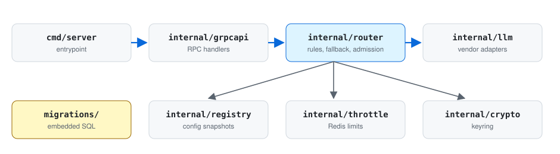

# Development

**The problem.** A change to a gateway touches contracts other services depend on: the proto, the
usage events, the configuration and the docs.

**The approach.** A few `make` targets build, test and regenerate everything, and CI checks that the
contracts, the generated code and the docs stay in step with the code.

<p align="center"></p>

## Try it

```bash
docker compose up --build   # local stack with Postgres + Redis
make test                   # go test -race ./...
```

| Target | Does |
| --- | --- |
| `make build` | Binaries in `bin/`. |
| `make test` | `go test -race ./...` |
| `make proto` | Regenerates `gen/` after editing `proto/` (needs `buf`). |
| `make proto-py`, `make proto-ts` | Python stubs in `gen/python/`, TypeScript in `gen/ts/`. |
| `make clients` | Regenerates the usage-sink stubs from `usage-proto/`. |

## Repository layout

| Path | What |
| --- | --- |
| `cmd/server` | The entrypoint. |
| `internal/grpcapi` | RPC handlers. |
| `internal/router` | Rule matching, fallback, admission. |
| `internal/registry` | Validated config snapshots. |
| `internal/llm` | The vendor-neutral chat model and the vendor adapters. |
| `internal/throttle` | Redis limits. |
| `internal/crypto` | The keyring. |
| `migrations/` | Embedded SQL. |

## Contracts

- `usage-proto/usage/v1/usage.proto` is a byte-for-byte copy of light-tokenmeter's, which owns it.
  CI fails when the copy or the stubs generated from it drift: copy the file over and run
  `make clients`.
- Every environment variable in `config.go` must be in `env.example` and
  [`docs/configuration.md`](configuration.md#configuration-reference); a test checks the docs.
- Skills may link only to docs sections that exist; a test checks that too.

Pull requests are welcome; read [`CONTRIBUTING.md`](../CONTRIBUTING.md) first. Maintainers release
as described in [`RELEASING.md`](../RELEASING.md).
