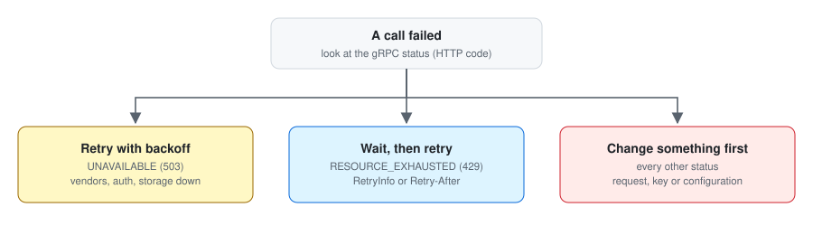

# Error contract

**The problem.** A client that cannot tell "try again later" from "this will never work" either
hammers a broken call or gives up on one that would pass in a second.

**The approach.** Every error is a gRPC status plus a short machine-readable **reason**. The status
says what to do; the reason says why. Over HTTP the same reason is the `code` of the
[error body](http-api.md#errors). These codes and reasons are part of the [stable API](stability.md#what-is-public).

## Glossary

| Term | Meaning |
| --- | --- |
| **Status** | The gRPC code: `UNAVAILABLE`, `RESOURCE_EXHAUSTED`, `FAILED_PRECONDITION`… |
| **Reason** | A stable string in the message, such as `throttled:key_rpm` or `no_capable_model`. |
| **`RetryInfo`** | A gRPC error detail with how long to wait; over HTTP, the `Retry-After` header. |
| **Chain** | The models a call may try; `vendors_unavailable` means all of them failed. |

## RPC status codes

### Retry with backoff

| gRPC status | Reason | What it means |
| --- | --- | --- |
| `UNAVAILABLE` | `vendors_unavailable` | The whole chain failed. When vendors paused every model of the chain with `Retry-After`, details carry `RetryInfo` (HTTP `Retry-After`): wait that long first. |
| `UNAVAILABLE` | `auth_unavailable`, `storage_unavailable` | Postgres is unreachable for a key check (past `AUTH_STALE_IF_ERROR`) or a batch or admin write. |
| `UNAVAILABLE` | `throttled:spend_unavailable` | Spend counters are unreachable with `SPEND_LIMITS_FAIL_MODE=closed`. |

### Wait, then retry

| gRPC status | Reason | What it means |
| --- | --- | --- |
| `RESOURCE_EXHAUSTED` | `throttled:key_rpm`, `throttled:key_tpm` | The key's own `rpm_limit` or `tpm_limit`. Details carry `RetryInfo`: wait that long. |
| `RESOURCE_EXHAUSTED` | `throttled:rpm`, `throttled:budget_key`, `throttled:budget_user` | A model's rate or the daily token budget. Back off; don't hot-retry. A batch is refused at submission when the budget is gone. |
| `RESOURCE_EXHAUSTED` | `throttled:spend_key_daily`, `throttled:spend_key_monthly`, `throttled:spend_user_daily`, `throttled:spend_user_monthly`, `throttled:spend_team_monthly` | A spend limit is reached. Details carry `ErrorInfo{reason: "insufficient_quota"}` and `RetryInfo` until the period resets. |

### Change something first

| gRPC status | Reason | What to do |
| --- | --- | --- |
| `INVALID_ARGUMENT` | `guardrail_violation` | Prompt injection, PII or a latent-space threat was found. Clean the input. |
| `INVALID_ARGUMENT` | `bad_request: <message>` | Empty batch, duplicate `custom_id`, too many items (> `BATCH_MAX_ITEMS`), or invalid parameters. |
| `FAILED_PRECONDITION` | `request_too_large` | The call needs more tokens than a minute of the key's `tpm_limit`; it never fits. Shrink it or raise the limit. |
| `FAILED_PRECONDITION` | `output_truncated` | Raise `max_output_tokens`; don't retry as is. |
| `FAILED_PRECONDITION` | `no_capable_model` | No model of the chain can serve this request, modality or batch. |
| `FAILED_PRECONDITION` | `unsupported_language_pair` | `Translate`: models of the chain translate, but none declares this pair. Add a model for it or a `*` fallback. |
| `FAILED_PRECONDITION` | `no_vendor_key` | The client key holds no credential for the chain's vendors. `local` models never cause this. |
| `FAILED_PRECONDITION` | `not_configured` | No models or rules yet. |
| `FAILED_PRECONDITION` | `batch not configured` | Batch processing is not enabled (no batch store). |
| `PERMISSION_DENIED` | `model "<id>" not allowed for <key\|team>`, `no models in chain allowed for <key\|team>`, `model access denied by key or team policy` (batch) | The key's or its team's `allowed_models` excludes that model. |
| `UNAUTHENTICATED` / `PERMISSION_DENIED` | – | The key is missing or invalid, or lacks the scope. |
| `NOT_FOUND` | – | Unknown batch ID. |
| `UNIMPLEMENTED` | `ffmpeg_missing` | Gemini speech without ffmpeg (the slim image). Install ffmpeg or use the `:audio` image. |
| `INTERNAL` | `vendor_error` | A terminal vendor failure. |

In short: `UNAVAILABLE` → retry with backoff; `RESOURCE_EXHAUSTED` → wait as long as it says
(`RetryInfo`, HTTP `Retry-After`), or back off when it says nothing. Every other status fails the
same way until the request or the configuration changes.

## Batch item error reasons

A failed item in `ListBatchResults` has an `error` with a gRPC code, a message and one of these
reasons:

| Reason | When | What to do |
| --- | --- | --- |
| `output_truncated` | The item reached `max_output_tokens` or the candidate's finish limit. | Resubmit it with a higher `max_output_tokens`. |
| `vendor_error` | The vendor failed on it, or the answer did not match the schema. | Retry it synchronously or in another batch. |
| `batch_expired` | The vendor batch expired (after 48 h) before the item finished. | Resubmit it. |
| `batch_cancelled` | The batch was cancelled before the item finished. | Resubmit it if still needed. |
