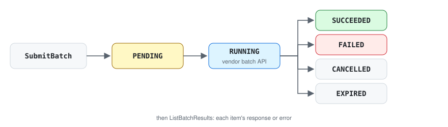

# Calling Keystone

**The problem.** Services need more than chat: typed JSON output, cheap batch jobs, speech, images,
judgments, translation and embeddings. Each vendor exposes these differently, and some only for
some models.

**The approach.** One gRPC service, `ktms.v1.GatewayService` on `:9090`, has an RPC per kind of work.
A request describes the work (needs, attributes, schema); Keystone picks the model, checks the
answer, falls back and accounts for it. The same RPCs are on [HTTP](http-api.md#openai-compatible-http-api).

**Contents:** [Glossary](#glossary) · [Try it](#try-it) · [Clients](#client-sdks) ·
[GenerateText](#generatetext) · [Sampling](#sampling) · [Streaming](#generatetextstream) ·
[Batches](#batch-text-generation) · [Speech and images](#synthesizespeech-generateimage) ·
[Judge](#judge) · [Translation](#translation) · [Embeddings](#embeddings) · [ListModels](#listmodels)

## Glossary

| Term | Meaning |
| --- | --- |
| **Needs** | What a request needs: topic → level; see [Needs and competencies](concepts.md#needs-and-competencies). |
| **Attributes** | Your context for rules and usage: `user_id`, `usage_project`, anything else. |
| **`action_id`** | Your label for the call site in usage reports, e.g. `app.summarize`. |
| **Response schema** | A JSON Schema the answer must follow; Keystone checks it where the vendor does not. |
| **Batch** | Many generations sent to a vendor's batch API at half price, answered within a day. |
| **Judge** | Typed answers (yes/no, choice, score) with probabilities instead of text. |

## Try it

Every call carries `authorization: Bearer ktms_…` metadata (legacy `llm_…` keys work too). gRPC
reflection is on, so `grpcurl` needs no `.proto` files:

```bash
grpcurl -plaintext -H "authorization: Bearer ktms_<key>" -d '{
  "needs": {"general": "basic"},
  "messages": [{"role": "MESSAGE_ROLE_USER", "text": "Say hi in three words."}],
  "max_output_tokens": 50
}' localhost:9090 ktms.v1.GatewayService/GenerateText
```

## Client SDKs

| Language | How |
| --- | --- |
| Go | `go get github.com/ai-process/ktms/gen/ktms/v1` (the committed stubs) |
| Python | `make proto-py` → `gen/python/` |
| TypeScript | `make proto-ts` → `gen/ts/` |
| Other | Generate from `proto/ktms/v1` with `buf`. |

`make proto` regenerates the Go stubs in `gen/`; all targets use `buf` remote plugins, so no local
compiler plugins are needed. Pre-built SDKs on the Buf Schema Registry are planned and will be
announced in the CHANGELOG when they are published.

## GenerateText

```json
{
  "needs": {"general": "proficient", "legal": "basic"},
  "attributes": {"language": "es", "user_id": "u-42", "task": "summary"},
  "base_system_instruction": "You are a concise assistant.",
  "request_instruction": "Answer in one paragraph.",
  "messages": [{"role": "MESSAGE_ROLE_USER", "text": "Summarize …"}],
  "response_schema": {"type": "object",
    "properties": {"summary": {"type": "string"}}, "required": ["summary"]},
  "max_output_tokens": 800,
  "action_id": "app.summarize"
}
```

**Routing fields.**

| Field | Notes |
| --- | --- |
| `needs` | What the request needs: topic → `basic`, `proficient` or `expert`. |
| `attributes` | Opaque key/values matched by rules and copied to usage events. `user_id` charges the per-user daily budget (falls back to `svc:<key_name>` for service callers without `user_id`). `usage_project` overrides the usage project. |
| `placement` | `nodes_first`, `nodes_only`, `cloud_first`, `cloud_only`. |
| `data_classification` | `restricted` keeps the call and the judge calls it makes on your own nodes, with no cloud fallback; see [Restricted data](concepts.md#restricted-data). |
| `model_override` | Exact model id; bypasses rules but **not** limits. |
| `auto_route` | Smart model selection; without needs or a pinned effort, a judge picks the general level. |
| `action_id` | Free-form label for usage attribution. |
| `effort` | Deprecated: `EFFORT_LOW`, `EFFORT_MEDIUM`, `EFFORT_HIGH` are `general` at `basic`, `proficient`, `expert`; `needs.general` wins over it. |
| `effort_specified` | Deprecated: the caller pinned the effort (skips the judge). Needs count as pinned. |

**Content fields.**

| Field | Notes |
| --- | --- |
| `base_system_instruction`, `request_instruction` | System content; it never travels as a message. |
| `messages` | Chat history: `MESSAGE_ROLE_USER`, `MESSAGE_ROLE_ASSISTANT` and `MESSAGE_ROLE_TOOL` (with `tool_call_id`). User messages take multimodal `parts` (`ContentPart`: `text`, `image`, `audio`, `document`). Assistant messages can carry `tool_calls`. |
| `response_schema` | Unset = free text. Set = JSON in that shape: types `string`, `integer`, `number`, `boolean`, `object`, `array`, plus `required`, `nullable`, `enum`, `format` and `additional_properties`. Vendors with structured output enforce it; for the others Keystone checks the reply (types, required keys, enum values, extra keys when `additional_properties` is false), retries once and then falls back. A `format` a vendor rejects reaches the model in the description. |
| `tools`, `tool_choice` | Function declarations with JSON Schema parameters; `tool_choice` is auto, required, none or a named function. In non-streaming calls the arguments of `strict` tools are checked, since not every vendor enforces strict; a call outside them is retried once, then falls back. Streamed tool calls are not checked. |
| `max_output_tokens` | Ceiling, `0` = none. Output tokens are the expensive ones; set it. |
| `temperature`, `top_p`, `stop`, `seed` | Sampling for the serving model; unset leaves its default. `temperature` 0..2, `top_p` 0..1, up to 16 non-empty `stop` sequences; other values are `INVALID_ARGUMENT`. See [Sampling](#sampling). |
| `enable_google_search` | Only Google models declaring `google_search` can serve it. |

**The response** carries `choices`, token `usage`, `resolved_model`, `resolved_vendor`,
`matched_rule` (empty on override), `details` (`Choice` objects with text, tool calls and finish
reasons), `cached`, the routing metadata `route_mode`, `placement`, `judge_score` and `judge_model`,
and `ignored_parameters`: the sampling fields the resolved model did not get.

## Sampling

`temperature`, `top_p`, `stop` and `seed` reach the serving model as far as its API takes them.

- A field the model does not take is left out of its request instead of failing the call.
- The response names it, and a value that was changed: `ignored_parameters` in gRPC (on the first
  chunk of a stream), the `X-KTMS-Ignored-Params` header over HTTP.
- Fallback models are judged one by one, so the list describes the model that answered.

| Vendor | Takes |
| --- | --- |
| `openai`, `azure` | All four, up to 4 `stop` sequences. Reasoning models (an id starting with `o<digit>`, `gpt-5`, `codex-mini` or `computer-use`, as a whole or after a `/`, `-` or `_`, except `gpt-5-chat`) take none: they reject `temperature`, `top_p` and `stop`, and `seed` is not confirmed for them. |
| `groq` | All four, up to 4 `stop` sequences. |
| `google` | All four, up to 5 `stop` sequences. |
| `ollama`, `local` | All four. |
| `deepseek` | `temperature`, `top_p`, `stop` (up to 16). |
| `mistral` | `temperature` (capped at 1.5), `top_p`, `stop`. |
| `anthropic`, Claude on `bedrock` | `stop`, without sequences of whitespace alone. Claude 4.6 and earlier also take `temperature` (capped at 1) and `top_p`; from Claude 4 on, not both: with both set, only `temperature`. Claude 4.7 and later accept only the default sampling, so they get neither. |
| Other `bedrock` models | `temperature` (capped at 1), `top_p`, up to 4 `stop` sequences. |
| `bedrock` application inference profiles (ARNs) | Up to 4 `stop` sequences: the ARN does not say which model is behind it. With `sampling` declared, also `temperature` (capped at 1) or `top_p`, not both, which every family takes. |

- A temperature above a vendor's cap is lowered to it and reported as `temperature`.
- When a vendor takes fewer stop sequences than the call has, it gets the first ones and `stop` is
  reported.
- The model is told apart by its id. When the id misleads, declare a capability: `no_sampling` for a
  model whose API rejects a field this table sends, `sampling` for one that takes what its vendor's
  row allows, such as an Azure deployment of a chat model named like a reasoning one.
- Sampling is part of the response cache key. Batch results carry no `ignored_parameters`. Over
  HTTP, empty stop sequences are dropped before the call.

## GenerateTextStream

`rpc GenerateTextStream(GenerateTextStreamRequest) returns (stream GenerateTextChunk)`

- The request wraps a standard `GenerateTextRequest`.
- Chunks carry `delta` (text), `tool_call_chunks`, `resolved_model`, `resolved_vendor`,
  `matched_rule`, `cached`, `route_mode`, `placement`, `judge_score`, `judge_model`,
  `ignored_parameters`, and at the end `finish_reason` with token `usage`.
- **Fallback:** if models fail before the first chunk, the next model of the chain is tried. Once
  the first chunk is sent, the stream stays on that model.
- Usage events and daily token budgets are settled when the stream ends.

## Batch text generation

For offline work that cares about cost, not latency (page generation, backfills, pipelines): items
go to vendors' batch APIs (e.g. the Gemini Batch API) at a **50% discount**. Jobs usually finish
within 24 hours; vendors give up at 48.

<p align="center"></p>

| Aspect | Behaviour |
| --- | --- |
| Route | Resolved once, at submission: the first model of the rule's chain (or of the [selection](concepts.md#needs-and-competencies)) with the `batch` capability, a vendor key for the client (not needed for `local`) and daily budget left. No vendor fallback afterwards. |
| Privacy | Prompts go to the vendor and are never stored in Keystone's database. |
| Limits | RPM does not apply. Daily token budgets are checked at submission (refused when exhausted) and charged when results arrive. |
| Retention | Results are kept `RESULTS_RETENTION_DAYS` (7 days; integer days or a Go duration). |

### SubmitBatch

Takes items (`custom_id`, unique within the batch, and a `GenerateTextRequest`), batch-level `needs`
(or the deprecated `effort`) and `attributes`, and an optional `client_batch_id`: resubmitting with
the same id returns the existing batch.

```bash
grpcurl -plaintext -H "authorization: Bearer ktms_<key>" -d '{
  "needs": {"general": "basic"},
  "attributes": {"task": "catalog_enrichment"},
  "client_batch_id": "job-2026-10-07-001",
  "items": [
    {
      "custom_id": "item-1",
      "request": {
        "messages": [{"role": "MESSAGE_ROLE_USER", "text": "Extract attributes from product 1"}],
        "response_schema": {"type": "object", "properties": {"color": {"type": "string"}}, "required": ["color"]}
      }
    },
    {
      "custom_id": "item-2",
      "request": {
        "messages": [{"role": "MESSAGE_ROLE_USER", "text": "Extract attributes from product 2"}],
        "response_schema": {"type": "object", "properties": {"color": {"type": "string"}}, "required": ["color"]}
      }
    }
  ]
}' localhost:9090 ktms.v1.GatewayService/SubmitBatch
```

Returns a `Batch` in `BATCH_STATE_PENDING` (or `BATCH_STATE_RUNNING`) with the item count, the model
and the creation time.

### GetBatch

State (`PENDING`, `RUNNING`, `SUCCEEDED`, `FAILED`, `CANCELLED`, `EXPIRED`) and progress (`total`,
`done`, `failed`):

```bash
grpcurl -plaintext -H "authorization: Bearer ktms_<key>" -d '{
  "batch_id": "0199c0a0-6228-7e10-91b5-685d996cbfa1"
}' localhost:9090 ktms.v1.GatewayService/GetBatch
```

### ListBatchResults

Pages through finished items with `page_token` / `next_page_token`. Each item has its `custom_id` and
either a `response` (`GenerateTextResponse`) or an `error` (`BatchItemError` with a gRPC code, a
message and a [reason](errors.md#batch-item-error-reasons)):

```bash
grpcurl -plaintext -H "authorization: Bearer ktms_<key>" -d '{
  "batch_id": "0199c0a0-6228-7e10-91b5-685d996cbfa1",
  "page_size": 100
}' localhost:9090 ktms.v1.GatewayService/ListBatchResults
```

### CancelBatch

Asks the vendor to cancel. The batch stays `RUNNING` until the vendor confirms: finished items keep
their results, and the rest fail with `batch_cancelled`.

```bash
grpcurl -plaintext -H "authorization: Bearer ktms_<key>" -d '{
  "batch_id": "0199c0a0-6228-7e10-91b5-685d996cbfa1"
}' localhost:9090 ktms.v1.GatewayService/CancelBatch
```

## SynthesizeSpeech, GenerateImage

| RPC | Takes | Returns |
| --- | --- | --- |
| `SynthesizeSpeech` | `text` (read verbatim), optional `language` | OGG/Opus `audio` |
| `GenerateImage` | `prompt` | `image` bytes with a `mime_type` |

Both take `attributes`, `action_id` and `model_override`, and need the rules in
[Speech, image and judgment rules](configuration.md#speech-image-and-judgment-rules).

## Judge

`Judge` answers typed questions about one state instead of writing text: you get calibrated
probabilities to branch on, not prose to parse. All questions of a call are answered against the same
state, in parallel.

| Type | Question | Answer |
| --- | --- | --- |
| `JUDGE_TYPE_NOUL` | Does this hold? | probability of yes (`noul`, 0–1) |
| `JUDGE_TYPE_CHOICE` | Which one? | `choice` plus full `probabilities` and `confidence` |
| `JUDGE_TYPE_SCORE` | How much? | probability-weighted position on ordered `levels` |
| `JUDGE_TYPE_BOX` (experimental) | Where on the image? | one `box` (`top`, `bottom`, `left`, `right`, fractions of the image from its top-left corner) and `confidence`, or `confidence_unset` when the vendor gives none |

```json
{
  "state_json": "{\"message\":\"My card was charged twice!\"}",
  "questions": {
    "angry": {"type": "JUDGE_TYPE_NOUL", "instructions": "Is the author upset?"},
    "topic": {"type": "JUDGE_TYPE_CHOICE", "instructions": "What is this about?",
              "options": {"billing": "payments and charges", "bug": "software defects"}}
  }
}
```

- **Multimodal state** goes in `state_media` (`text`, `image`, `audio`, `embedding` parts), with or
  instead of `state_json`. Each media kind narrows the chain to judge models that also declare
  `vision`, `audio_input` or `embedding_input`. A box question also needs `box`.
- **Images at TypeSafe** (experimental, "Dreamer-ready" at the vendor): image bytes in `state_media`
  go to System One as assets. A part's `name` is how `state_json`, instructions, options, levels and
  criteria refer to it, so put example images for choice options or score levels in `state_media`
  too and name them there; unnamed images are listed beside the state as
  `{"state": <state_json>, "images": [...]}`. TypeSafe takes PNG or JPEG only, each side 280–1568 px,
  at most 16 MiB a file, upright pixels: Keystone checks that from the image header before the call
  and answers `bad_request` with the size and the limit, never resizing or rotating. Image URLs,
  audio and embeddings make TypeSafe yield to the next model. Other judges get a named part's name
  as a text label before it.
- **Other System One vendors** (experimental): `liquid` (d1), `cloudflare` (Clef), `perplexity`
  (pplx-decider) and `microsoft` (Microsoft-Decision on Foundry) take the same questions. Liquid and
  Cloudflare get images as an `images` array and Perplexity as image parts inside the state; these
  vendors take images by position, so named images send their names with the state in order
  (`{"state": …, "images": ["road", …]}`, or a text part before each image at Perplexity). Limits
  checked before the call: Liquid 8 images (1 with a box question), Cloudflare 4 images up to 16 MP,
  Perplexity 8 images up to 2,048 tiles of 32×32 px; 4 MiB a file at Liquid and Cloudflare. Microsoft is
  text only: images make it yield.
- **Box** (experimental) is TypeSafe `jev-1.14.0` (and Liquid `d1.2`) only: declare `box` on that model and pin the
  version rather than `jev-latest`. A missing object still gets a box, so ask a noul "is it there?"
  beside it. `ExplainRoute` shows a box chain when you pass `capabilities: ["box"]`.
- **Structured questions** (experimental): `instructions_json` and `criteria_json` take the JSON
  forms System One accepts, such as `["Which defect is in", "road", "?"]` or a choice option
  `{"description": "a pothole", "examples": ["ex-pothole"]}` with example images named in
  `state_media`. TypeSafe gets them as they are; other judges get them as text. `criteria_json`
  replaces `options`, `levels` and the criteria pair.
- **Long context**: declare `long_context` on a TypeSafe model to send System One's long-context
  header on every call (262k tokens per request and per question instead of 64k and 32k).
- **Sizes**: one request carries at most 16 MiB of media, below TypeSafe's 32 MiB. gRPC messages are
  capped by `GRPC_MAX_RECV_MSG_SIZE` (16 MiB by default) and HTTP bodies at 16 MiB, where base64
  leaves about 12 MiB of image bytes. Keystone keeps
  that ceiling: frames at 1568 px are well under it, and larger judge requests belong in several
  calls. Usage events count the images of each call in meta `images`; their tokens are in
  `usage.input`.
- **Patterns** stay on the client and need no gateway support: a cheap noul ("is the frame
  usable?") before an expensive question, a choice plus a noul ("is this about it at all?"),
  routing on `confidence`, a composite of several scores, and all questions about one state in one
  request (one state's tokens).
- Image URLs must be `https` and are forwarded, not fetched. Guardrails inspect text parts only.
- Limits: 32 parts, 16 MiB of media, 16384 embedding dimensions.
- Judge vendors: [TypeSafe](https://typesafe.ai) (`jev-latest`, billing input only) and
  [OpenAI](https://openai.com) (`gpt-6-luna`, billing input and output tokens). Both write no text
  and declare the `judge` capability.

## Translation

`Translate` (HTTP `POST /v1/translate`, same JSON) translates a batch of texts. The client always
makes the same call; which engine translates is the translate rule's choice: a local MT model on a
node, any chat model by prompt, or a cloud MT vendor, with the usual fallback, limits, guardrails and
usage. Comparing engines is a config change, not a code change.

```json
{"texts": ["Great location, friendly staff.", "Chambre trop petite."],
 "source_language": "",          // BCP-47; empty detects each text
 "target_language": "de",
 "format": "text",               // or "html": tags and attributes are kept
 "attributes": {"pipeline": "reviews"}, "action_id": "reviews.translate"}
```

- **The reply** has one `translations[]` entry per text, in order (`text`,
  `detected_source_language`), with `resolved_model`, `matched_rule` and `usage` (tokens as the
  engine counts them, and `characters`).
- **Limits:** 128 texts and 256 KiB per call. Blank texts come back as they are; a
  `source_language` equal to the target returns the texts without a call.
- **Language pairs:** translate models declare the `translate` capability and `languages` (required,
  `"*"` for any). A model without the request's pair is skipped, not tried. A tag covers its longer
  variants: `"de"` takes `"de-AT"`, `"zh-Hant"` takes `"zh-Hant-TW"`.

```yaml
models:
  - id: opus-mt-de              # a node MT model (ktms-mt, see Nodes)
    vendor: local
    efforts: [EFFORT_LOW]
    capabilities: [translate]
    languages: {source: [en, fr, es, it, nl, pt, pl, ru, tr], target: [de]}
  - id: gemma4:26b              # any chat model, by prompt
    vendor: local
    efforts: [EFFORT_LOW]
    capabilities: [translate]
    languages: {source: ["*"], target: ["*"]}
  - id: gemini-2.5-flash
    vendor: google
    efforts: [EFFORT_LOW, EFFORT_MEDIUM]
    capabilities: [translate]
    languages: {source: ["*"], target: ["*"]}
    price_in_per_mtok: 0.30
    price_out_per_mtok: 2.50
rules:
  - name: translate             # local MT first, then the local LLM, then the cloud
    priority: 170
    attributes: {modality: translate}
    use: [opus-mt-de, gemma4:26b, gemini-2.5-flash]
  - name: translate-gemma       # a pipeline that asks for Gemma by an attribute
    priority: 171
    attributes: {modality: translate, engine: gemma}
    use: [gemma4:26b, gemini-2.5-flash]
```

- **A chat model** translates through a prompt Keystone writes: the texts go as JSON data, the reply
  is structured output with one item per text, and Keystone checks the count and the ids. A reply
  that does not line up is retried once on the same model, then the chain moves on. Batches are split
  into chunks of up to 32 texts.
- **Usage:** `action_id` defaults to `translate`, tokens are reported as usual, the character count
  goes in `meta.characters`, and `cost_nanousd` adds `price_per_million_chars` to the token price. A
  failed attempt bills its tokens only; characters are billed once, by the translation delivered.
  Spend limits count both.
- **CLI:** `ktms translate --to de [--from en] [FILE|-]` translates a file line by line;
  `ktms route explain KEY --modality translate --from fr --to de` shows which models a pair reaches.

## Embeddings

Vectors for text. To keep vector indexes consistent, `auto` routing and cross-model fallback are not
allowed: name the model. Models must declare the `embedding` capability.

```bash
grpcurl -plaintext -H "authorization: Bearer ktms_<key>" -d '{
  "model": "text-embedding-3-small",
  "inputs": ["Hello world", "Search document"]
}' localhost:9090 ktms.v1.GatewayService/GetEmbeddings
```

## ListModels

The models the calling key can use (those whose vendor it holds a key for), with competencies
(efforts read as `general`), the deprecated efforts, capabilities, rpm and prices.
