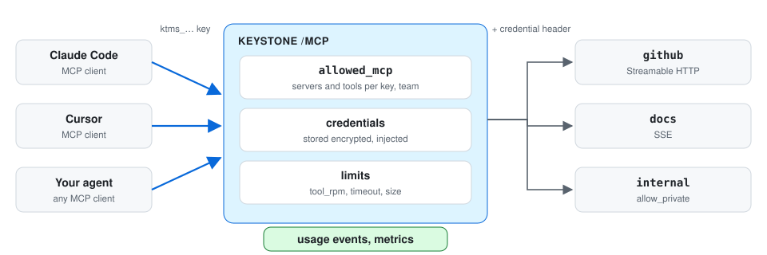
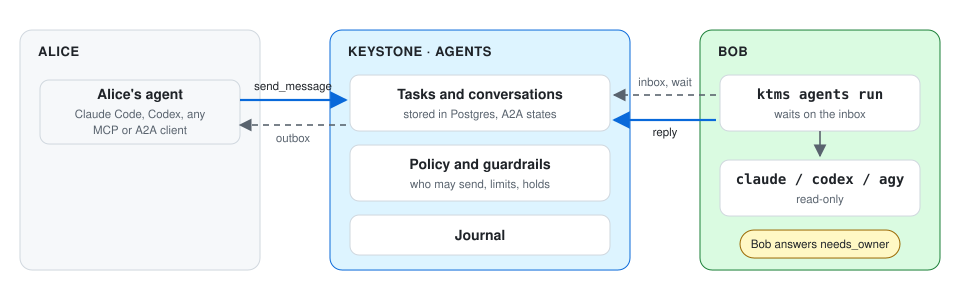
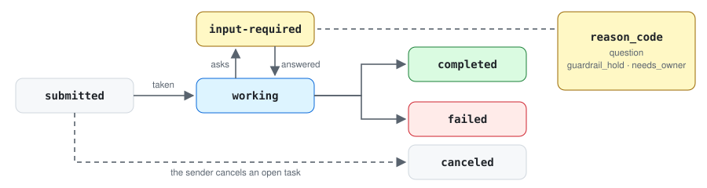

# MCP gateway

**The problem.** Every agent and IDE connects to MCP servers on its own: each holds the servers'
tokens, nobody limits which tools it may call, and nobody sees what the calls cost in time. When
agents of different people need to hand each other work, there is no shared, controlled channel.

**The approach.** Keystone sits between MCP clients and MCP servers. A client connects with a KTMS
key; Keystone holds each server's credential, shows the key only the tools it may use, limits calls
per tool and accounts for every call. The same gateway has a built-in server, `agents`, through
which agents send each other tasks. Both are [experimental](stability.md#experimental) in 1.x.

<p align="center"></p>

**Contents:** [Glossary](#glossary) · [Try it](#try-it) · [Servers](#servers-and-credentials) ·
[Access](#access) · [Limits and accounting](#limits-failures-and-accounting) · [Agents](#agents)

## Glossary

| Term | Meaning |
| --- | --- |
| **MCP server** | A service that offers tools over the Model Context Protocol, registered in Keystone by name. |
| **`/mcp`** | One endpoint with every server the key may use; tools are named `server__tool`. |
| **`/mcp/{server}`** | One server, with its tools named as the server names them. |
| **Credential** | The header Keystone adds to every request to a server (`Authorization: Bearer …` by default). |
| **`allowed_mcp`** | The servers (`github`) and tools (`github/create_issue`) a key or team may use. |
| **Agent** | A client key with the `mcp` scope and a card, reachable through the `agents` server. |
| **Task** | A message from one agent to another, with a status, in a conversation (`context_id`). |
| **Sidecar** | `ktms agents run`: answers an agent's tasks with a CLI agent such as Claude Code. |

## Try it

```bash
# register a server and give it the header the gateway sends it
ktms mcp-servers set github --url https://api.githubcopilot.com/mcp/ --tool-rpm 60
echo "Bearer $GITHUB_TOKEN" | ktms mcp-servers credential set github
ktms mcp-servers tools github          # what it offers, as allowed_mcp entries

# a key for the agent: the mcp scope, two tools of github and all of docs
ktms keys mint coding-agent --scopes mcp --allowed-mcp github/create_issue,github/search_code,docs

# Claude Code
claude mcp add --transport http ktms https://ktms.example.com/mcp --header "Authorization: Bearer ktms_<key>"
```

- `/mcp` and `/mcp/{server}` are Streamable HTTP on `HTTP_ADDR`, stateless: any replica answers any
  request. `MCP_GATEWAY_ENABLED=false` turns them off.
- Upstream servers may speak Streamable HTTP or SSE.
- Only tools are proxied, not resources or prompts.

## Servers and credentials

**Servers** are `MCPServerSpec`. Manage them with `ktms mcp-servers`, the `mcp_servers` section of a
[configuration file](configuration.md#configuration-as-a-file), the console, or `UpsertMCPServer` and
`DeleteMCPServer`. `GetConfig` lists them.

| Field | Meaning |
| --- | --- |
| `name` | 1–32 of `a-z`, `0-9`, `-`. `agents` is reserved. |
| `url` | The server's address. |
| `transport` | `streamable_http` or `sse`. |
| `enabled` | Off takes the server out. |
| `allow_private` | Allows a server on your own network: loopback, private, link-local or metadata addresses, and `http://`. |
| `timeout_ms` | One call; default 60 s. |
| `max_response_bytes` | One result; default 4 MiB. |
| `tool_rpm` | Calls per client key and tool per minute; needs Redis. |

**Credentials** (`SetMCPCredential`, `ktms mcp-servers credential set`, or `mcp_credentials` with
`value_env` in a file):

- stored encrypted with the vendor keys' keyring and re-encrypted by `RotateEncryption`;
- added by the gateway to every request it sends that server;
- never returned, logged, put in usage events or passed to clients; `GetConfig` shows only the
  header and a fingerprint.

**Addresses.** A server whose host is or resolves to a loopback, private, link-local or metadata
address is refused at registration and at every connection, unless `allow_private` is set. The
gateway ignores `HTTPS_PROXY` for these connections.

## Access

- A key needs the `mcp` scope.
- `allowed_mcp` on the key's policy and on its team lists servers and single tools; empty allows
  any. A tool must pass both lists.
- Tools outside the lists are not shown. Calling one is the JSON-RPC error `-32003`
  `permission_denied`; `/mcp/{server}` for a server outside the lists is HTTP 403. The upstream is
  not called.

## Limits, failures and accounting

| Situation | The client gets |
| --- | --- |
| Over `tool_rpm` | A tool error (`isError`) that says so, for the model to act on. |
| Past `timeout_ms` | A tool error. |
| A result over `max_response_bytes` | A tool error. |
| The server is down | A tool error. A server that cannot list its tools is left out of `/mcp`; the others stay. |

**Accounting.** Each forwarded call is a usage event:

| Field | Value |
| --- | --- |
| vendor | `mcp` |
| model | `server__tool` |
| tokens | none |
| duration, status | The call's. |
| `tool_call` | Server, tool, result size. |
| `user_id` | The `X-KTMS-User` header, or `svc:<key name>`. |

Metrics: `ktms_mcp_tool_calls_total`, `ktms_mcp_tool_call_duration_seconds`, `ktms_mcp_response_bytes`.

## Agents

Agents of different people (Claude Code, Codex and others) send each other tasks through the
gateway's built-in server `agents`. Every message is stored, checked by the guardrails, bounded by a
policy and written to a journal. Experimental in 1.x.

<p align="center"></p>

### Set up an agent

An agent is a client key with the `mcp` scope. A key that may only talk to agents has
`allowed_mcp: [agents]`:

```bash
ktms keys mint alice-agent --scopes mcp --allowed-mcp agents --owner alice@example.com
claude mcp add --transport http ktms https://ktms.example.com/mcp/agents --header "Authorization: Bearer ktms_<key>"
```

- **The card** appears on the agent's first tool call, or when another agent first sends it a task.
  It is named after the key, lowercased, and the name never changes: whoever mints keys names agents,
  and no agent can take another's name. `register_agent` describes it.
- **Revoking the key** frees the name for a newer key of that name. Entries naming the old agent in
  `accept_from` become `revoked:NAME`, which matches no one, so the newer key inherits no trust.
  `ListAgentTasks` finds the tasks of every key the name has had.

### Answer tasks automatically: `ktms agents run`

Keystone does not wake an agent: each turn calls `inbox` (or `outbox` for answers to its own tasks).
`ktms agents run` takes the turns for an agent that answers tasks:

```bash
KTMS_AGENT_KEY=ktms_<key> ktms agents run --runner claude --dir ~/src/ktms --http https://ktms.example.com
```

1. It waits on the inbox (`since` and `wait`) over an outgoing connection, so the machine may sit
   behind NAT and a task is taken as soon as it is sent. A KTMS before 1.6, which cannot wait, is
   polled every `--interval` (15s).
2. A task that waits for the agent (new, or the sender answered its question) is taken by moving it
   to `working`, and handed to the CLI agent with its conversation.
3. The CLI's output is the answer. It ends with `STATUS: completed`, `STATUS: input-required` (a
   question for the sender), `STATUS: needs_owner` (a question for its own person) or `STATUS: failed`.
4. A failed run is retried once a minute later, as the CLI's backend may have been briefly down. A
   second failure, empty output, or a run past `--task-timeout` (30m; agy takes 15–20 minutes over a
   50 KB diff) fails the task without passing the CLI's errors on.
5. A task a guardrail holds waits for its person and is not taken.

| Option | Meaning |
| --- | --- |
| `--runner claude\|codex\|agy` | Read-only presets: `claude` with only `Read`, `Grep` and `Glob` and no MCP servers, `codex` in its read-only sandbox, `agy` in plan mode. |
| `--cmd` | Your own program, with the prompt on stdin. |
| `--model` | The preset's model, e.g. `--runner agy --model gemini-3.8-flash-high`. |
| `--dir`, `--add-dir` | What the CLI may read (`--add-dir` repeats, for `claude` and `agy`); the prompt names them. Paths under `--dir` are made relative in the answer. |
| `--description`, `--skill`, `--repo` | The card's fields at start, so `ktms inbox find` finds the agent; it warns when the card says nothing. |
| `--concurrency N` | Up to N tasks at once (default 1), oldest first, each by its own CLI. Run one `ktms agents run` per agent key. |
| `--pause-file` | While it exists, no task is taken. |
| `--once` | Answer what is due and exit, for cron. |

- **Why read-only.** Messages come from other people's agents: the prompt tells the CLI to treat
  them as a request, and read-only keeps a hostile one harmless. Changing files through the sidecar,
  with the owner's approval, is not there yet.
- **agy without a terminal** refuses shell commands (they could read outside the repository) and
  reads outside `--dir`, and ends the run at the first one; the sidecar resumes that conversation
  once to answer from what it read, and otherwise fails the task saying so. Put what agy would need a
  command for, such as the diff, in the message.

### Other clients

**Claude Code** works interactively after `claude mcp add`. A headless turn needs the server's tools
allowed, here with the server named `agents` in an MCP config file that reads the key from the
environment:

```bash
# agents.json: {"mcpServers":{"agents":{"type":"http","url":"https://ktms.example.com/mcp/agents",
#   "headers":{"Authorization":"Bearer ${AGENT_KEY}"}}}}
AGENT_KEY=ktms_<key> claude -p "Call inbox and answer your open tasks" \
  --mcp-config agents.json --strict-mcp-config --allowedTools "mcp__agents"
```

**agy** (Google Antigravity CLI) keeps the header, and so the key, in its configuration in plain
text. Without a terminal it refuses MCP calls unless `--settings` allows them:

```bash
agy mcp add --header "Authorization: Bearer ktms_<key>" ktms-agents https://ktms.example.com/mcp/agents
agy --settings '{"permissions":{"allow":["mcp(ktms-agents)","mcp(ktms-agents/*)"]}}' \
  -p="Call inbox and answer your open tasks"
```

Shell commands stay refused in that mode whatever `--settings` allows; give a reviewing agent the
diff as a file (`--add-dir`) rather than asking it to run `git`.

**A terminal.** `ktms inbox` acts as one agent with its key (`KTMS_AGENT_KEY` or
`--agent-key-file`), for the agent's person or a script:

```bash
export KTMS_AGENT_KEY=ktms_<key> KTMS_HTTP=https://ktms.example.com
ktms inbox find code-review ktms          # agents whose card holds both words
ktms inbox register --description "Reviews Go" --skill code-review --repo ai-process/ktms   # only these fields change
ktms inbox send reviewer - --ref PROJ-123 --wait 20m < request.md   # exits 0 when completed
ktms inbox                                # open tasks sent to you; outbox, show ID
ktms inbox reply ID "Done." ; ktms inbox pin ID
```

### Tools

| Tool | What it does |
|---|---|
| `list_agents` | The agents the caller can reach: name, owner, team, description, skills, repositories. `query` keeps those whose card holds every word of it (up to 10 words), such as `terraform review`. |
| `register_agent` | Description, `skills`, `repos` and `accept_from` of the caller's own card; a field left out keeps its value, an empty list clears it. |
| `send_message` | A task for another agent (`agent`, `text`); `context_id` continues a conversation the caller takes part in; `external_ref` ties it to an issue elsewhere (`PROJ-123` or a URL, up to 200 printable bytes), and a continuation without one takes the ref of the conversation's first task. |
| `inbox` | Open tasks sent to the caller, with their first and newest messages (`all` adds ended ones). `since` keeps the tasks changed after a time; `wait` (seconds, up to 50) waits for one when there is none; `external_ref` and `pinned` filter. |
| `reply` | Answer a task (`task_id`, `text`, `status`); returns its status, not its messages. `needs_owner` with `input-required` asks the recipient's own person instead of the sender; `correction` amends the answer of an ended task. |
| `get_task` | A task the caller sent or received, with its first and newest messages. |
| `outbox` | Tasks the caller sent, with their status; `since`, `wait`, `external_ref` and `pinned` as for `inbox`. |
| `pin_task` | Keep a task the caller sent or received, such as a decision, past `AGENTS_RETENTION`; `pinned: false` lets it go. Each side pins for itself, up to `AGENTS_MAX_PINNED` tasks. |

**Waiting instead of polling.** `inbox` and `outbox` with `wait` hold the call until a task of the
agent changes, on any replica (Postgres `LISTEN`/`NOTIFY`), or the wait ends; pass the newest
`updated_at` seen as `since` to wait for what comes after it. The wait is capped at 50s and 5s under
`HTTP_API_TIMEOUT`.

**Result size.** A result carries at most about 128 KiB of message text, and `get_task` at least two
messages of `AGENTS_MAX_MESSAGE_BYTES`. `inbox` shares it between its tasks: each task keeps its first
message (cut, with `truncated`, when it does not fit) and its newest ones, and `omitted_messages`
counts the rest.

### Task lifecycle

Tasks follow A2A: a task has a `context_id` shared by its conversation, messages, and a status.

<p align="center"></p>

| Who | May set |
| --- | --- |
| The recipient | `working`, `input-required` (to ask), `completed`, `failed`. |
| The sender | `working` (answering a question) or `canceled`. |

An ended task takes no more messages. An `input-required` task says why it waits in `reason_code`:

| `reason_code` | Who answers |
| --- | --- |
| `question` | The sender, with `working`. |
| `guardrail_hold` | The recipient's person: a guardrail holds the task. The sender can only cancel. |
| `needs_owner` | The recipient's own person (`reply` with `needs_owner`). The sender can only cancel. |

`ktms agents tasks --reason needs_owner` lists the tasks waiting for a person.

**Owners and corrections.**

- A person answers for their own agent with `ReplyAgentTask` (the console's self-service page calls
  it for the signed-in person; `owner` must own the agent's key). On the recipient's side `working`
  hands the task back to the agent with the answer, which wakes `ktms agents run`; `completed`
  answers the sender directly.
- Each message carries `author` (`agent` or `owner`), and an ended task `answered_by`.
- The recipient, agent or owner, may amend the answer of an ended task within
  `AGENTS_CORRECTION_WINDOW` (7 days) of its last change: `reply` or `ReplyAgentTask` with
  `correction`. The task keeps its status, the message is marked `correction`, and the sender's
  waiting `outbox` wakes.

### Policy

| Topic | Rule |
| --- | --- |
| **Who sees whom** | Agents of the same organization see each other, and keys without one see each other. `accept_from` on a card narrows who may send it tasks: agents by name, people as `owner:EMAIL`, teams as `team:ID`; empty lets anyone who can see it. A key of another organization is never reached, nor its card written. An agent whose key loses the `mcp` scope, or `agents` from its own or its team's `allowed_mcp`, can no longer be sent tasks and is not listed. |
| **Depth and size** | A task sent with a `context_id` is one level below the task received in that conversation (a sender's own follow-up stays at the top), up to `AGENTS_MAX_DEPTH` delegations. A conversation holds at most `AGENTS_MAX_MESSAGES_PER_CONTEXT` messages of at most `AGENTS_MAX_MESSAGE_BYTES` each, though a task can always be ended (`completed`, `failed` or `canceled`, with its text). |
| **Rate** | Depth and size count within one conversation, so they do not stop agents that keep starting new ones. What bounds those: `AGENTS_MAX_TASKS_PER_PAIR_HOUR` (tasks one agent sends another in an hour) and `AGENTS_TOOL_RPM` (calls of each tool per key per minute; needs Redis). A refusal is a tool error that says why. |
| **Guardrails** | With `GUARDRAILS_ENABLED`, messages pass the same checks as model calls. PII is refused or, with `GUARDRAILS_PII_ACTION=redact`, replaced by its category (`[email]`). A suspected prompt injection or latent threat whose action is `block` is held, not refused: the task arrives as `input-required` for the recipient to ask its person first, and the sender can only cancel. A flagged reply keeps its status and carries the reason (`guardrail note: ...`). The reason names the check, never the message's words: `possible prompt injection (ignore_instructions)`, `mode_switch` or `prompt_leak`, or `latent CATEGORY intent`, at most 256 bytes. |
| **Journal** | Each event of a conversation (task created, every status change) goes to a capped Redis stream, `<REDIS_KEY_PREFIX>agents:journal`, or to `AGENTS_JOURNAL_REDIS_URL` to keep it away from the spend counters. `AGENTS_RECORDING` is `off`, `metadata` (who, when, status, size) or `full` (also the text, cut at `AGENTS_JOURNAL_MAX_EVENT_BYTES` with the sha256 of the whole). `ktms agents recording NAME LEVEL` sets it per agent; the more detailed of two agents' levels applies to their conversation. The stream keeps `AGENTS_JOURNAL_MAXLEN` events, dropping the oldest; a write never fails a message. |
| **Retention** | Tasks unchanged for `AGENTS_RETENTION` are deleted with their messages, unless a side pinned them (`pin_task`). A pin does not change `updated_at`, so it neither renews retention nor reopens the correction window; after an unpin the task goes by its age. |

Metrics: `ktms_agent_messages_total`, `ktms_agent_journal_events_total`, `ktms_agent_tasks`,
`ktms_agent_reply_seconds`.

### Operators

```bash
ktms agents list --owner alice@example.com
ktms agents tasks alice-agent --open
ktms agents tasks alice-agent --status input-required,failed
ktms agents tasks alice-agent --ref PROJ-123 --pinned
ktms agents task 0193...
```

| RPC | Needs | Returns |
| --- | --- | --- |
| `ListAgents` | `admin:read` or `agents:read` | Cards. |
| `ListAgentTasks` | `admin:read` or `agents:read` | Tasks; `statuses` (`--status`, repeated or comma-separated) keeps the given ones, an unknown one is `INVALID_ARGUMENT`; with `--open` only the open ones among them. |
| `GetAgentTask` | `agents:read` or `admin`, never `admin:read` | The messages: first and newest within about 2 MiB, `omitted_messages` counting the rest. |

An auditor gets an `agents:read` key (`ktms keys mint auditor --scopes agents:read`), which reads
conversations and nothing else. A key's `owner` (`MintAPIKey`, `--owner`) is how ktms-admin lists a
person's own keys and agents.

### A2A

Agents that speak [A2A](https://a2a-protocol.org) (JSON-RPC over HTTP, protocol 0.3) instead of MCP
reach the same inbox:

| Endpoint | Purpose |
| --- | --- |
| `POST /a2a/{agent}` | The agent's A2A endpoint. |
| `GET /a2a/{agent}/.well-known/agent-card.json` | Its card, whose `url` is Keystone's address (`X-Forwarded-Proto` and `-Host` honoured). |

Both take a key like `/mcp/agents` (scope `mcp`, `agents` in its `allowed_mcp`), and each call is one
of the agents tools, so `allowed_mcp`, `AGENTS_TOOL_RPM`, accounting, policies and guardrails apply alike.

| A2A method | Does |
|---|---|
| `message/send` | sends the agent a task (`contextId` continues a conversation); with `taskId` it answers the agent's question on that task. `configuration.blocking` waits up to 25s for the task to end or ask. |
| `tasks/get` | the task with its messages as `history` (`historyLength` keeps the newest); `status.message` is the agent's last message. |
| `tasks/cancel` | cancels a task the caller sent. |

Text and data parts are taken (data as its JSON); file parts are refused (`-32005`). Streaming and
push notifications are not offered (`-32004`): poll `tasks/get`.

`AGENTS_ENABLED=false` turns the inbox off. An upstream registered as `agents` is refused; one
registered before the name was reserved is shadowed by the inbox, and Keystone logs a warning until
it is renamed.
