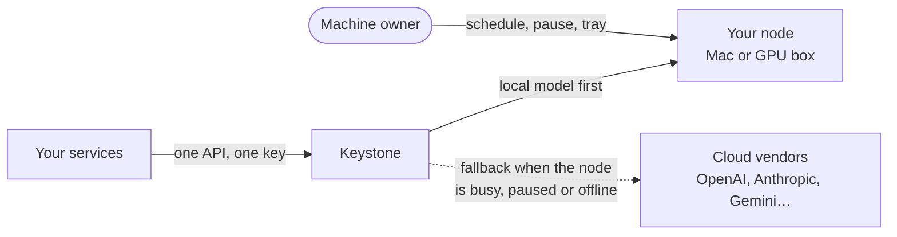
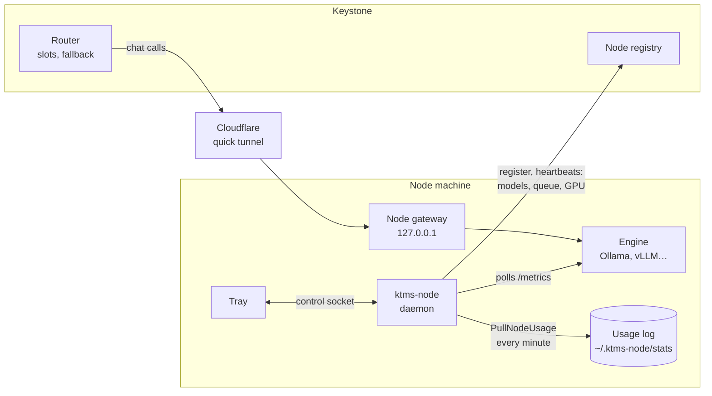

# Nodes

**The problem.** Cloud tokens cost money on every call, and some data must not leave your
machines. Meanwhile a Mac or a GPU box with enough memory for a good open model sits idle most of
the day.

**The approach.** Run `ktms-node` next to an inference engine on that machine. It registers the
engine's models with Keystone, and Keystone routes calls to it like to any vendor: with limits,
usage accounting and fallback to the cloud when the node is busy, paused or gone. The machine's
owner decides when it serves, with a schedule, a pause or the tray icon.



**Contents:** [Glossary](#glossary) · [Run a node in three steps](#run-a-node) ·
[How it works](#how-it-works) · [Engines](#engines) ·
[Keeping the machine free](#keeping-the-machine-free) · [Usage log](#usage-log) ·
[Translation node](#a-translation-node) · [Node daemon reference](#node-daemon) ·
[Troubleshooting](#if-the-node-does-not-show-up)

## Glossary

| Term | Meaning |
| --- | --- |
| **Node** | A machine with an inference engine that Keystone routes calls to. |
| **Engine** | The inference server on the node: Ollama, vLLM, TGI, llama.cpp, FreeToken or `ktms-mt` for translation. |
| **Node daemon** | `ktms-node`: registers the engine with Keystone, reports models and load, keeps the tunnel and the usage log. |
| **Node key** | `ktms_node_…`, the daemon's credential. Bound to one node id, optionally to some models and networks. |
| **Node id** | The machine's name in Keystone (`anna-mac`). One key, one id. |
| **Node gateway** | A small HTTP server the daemon puts in front of the engine. Forwards only chat and model listing. |
| **Quick tunnel** | A Cloudflare tunnel the daemon opens so Keystone can reach a machine without a public IP. |
| **Level** | The share of time the node serves Keystone, 0–100%. 0% is a pause. |
| **Slot** | One request the node may run at a time. Keystone gives `ceil(max_concurrent × level)` of them. |
| **Schedule** | Levels by local time, such as "100% at night, 0% in working hours". Kept on the node or in Keystone. |
| **Override** | A manual level or pause for 1 minute to 24 hours, on top of the schedule. |
| **Tray** | The menu bar (macOS) or tray (Linux) app for the owner. |
| **Usage log** | What the node served: requests, tokens, busy time. Stays on the machine. |

## Run a node

Three steps, no tunnels or service files to write and no admin rights on macOS. Works on an Apple
Silicon Mac, on Linux with an NVIDIA card, or slowly on any CPU.

### 1. The admin mints a key and registers the model

Whoever runs Keystone does this once per machine and once per model, with the
[`ktms` command](console-and-cli.md#command-line-tool):

```bash
ktms node-keys mint anna-mac --node-id anna-mac    # prints the ktms_node_… key once
```

```yaml
# node-model.yaml; apply with: ktms config apply -f node-model.yaml
api_version: ktms.ai-process.dev/v1alpha1
models:
  - id: "gemma4:26b-a4b-it-qat"        # exactly the Ollama tag the node serves
    vendor: local
    competencies: {general: basic}
    capabilities: [no_thinking]        # turns Gemma's reasoning off
    queue_timeout_ms: 2000
```

They hand the machine's owner three things: the key, the node id and the proxy address.

### 2. The owner runs one command

Replace the three values and paste the key when asked. The input is hidden, and the key goes to a
file only you can read.

```bash
curl -fsSL https://raw.githubusercontent.com/ai-process/ktms/vX.Y.Z/scripts/install-node.sh | sh -s -- \
  --proxy proxy.example.com --node-id anna-mac --model gemma4:26b-a4b-it-qat
```

What it does:

- downloads Ollama, the model and the node daemon (the model is large: the first run takes a while);
- starts them as background services and keeps the machine awake;
- waits until the node has registered.

Useful options:

| Option | What it adds |
| --- | --- |
| `--max-concurrency N` | Serve N requests at once (default 1). |
| `--schedule FILE` | Serve only at some hours: see [Schedule](#schedule). |
| `--tray` | The menu bar or tray app: see [Tray](#tray). |
| `--engine mt` / `--engine ollama,mt` | A [translation node](#a-translation-node), alone or next to chat. |
| `--endpoint URL` | You expose the node yourself; no tunnel. |
| `--dry-run` | Check the machine and print the plan, change nothing. |
| `--doctor` | Explain what is wrong with an installed node. |
| `--uninstall` | Remove everything (models stay in `~/.ollama`). |

All options: `install-node.sh --help`.

### 3. Check

The last lines of the installer say `Node anna-mac is running and registered`. The admin sees the
node `HEALTHY` with its model:

```bash
ktms nodes list
```

Send a call that needs `general: basic`, or name the model, and it runs on the node. Stop the node
and the same call goes to the next model in the chain.

**Updating.** Run the same command again. A re-run restarts only what changed, and a new daemon
that fails to start is rolled back.

## How it works



| Step | What happens |
| --- | --- |
| Register | The daemon dials Keystone over gRPC with the node key and reports the engine's models. |
| Heartbeat | Every 5 seconds (Keystone's `NODE_HEARTBEAT_INTERVAL_SECONDS`): loaded models, running and waiting requests, GPU, the current level. |
| Reach | Keystone dials the node, so the node must be reachable. The daemon opens a quick tunnel, or you give `--endpoint`. |
| Route | The router picks the node by weight and free slots; a full or paused node is skipped and the chain moves on. |
| Serve | The node gateway checks a per-process access key and forwards only `POST /v1/chat/completions` and `GET /v1/models`. Pulling or deleting models is not reachable. |
| Account | Usage goes to light-tokenmeter like any call; the node keeps its own log without user, key or text. |

**Tunnel notes.**

- The gateway pads slow responses so the tunnel's 100 s idle cutoff does not drop them.
- Quick tunnels have no SLA, and their address changes on restart. The daemon re-registers by itself.
  For a stable address use `--expose=none` and your own `--endpoint`.
- cloudflared must be 2026.10.3 or newer (older ones trust the leaked eMudhra intermediates). The
  daemon warns, `ktms-node doctor` reports it, and re-running the installer updates it.

**When Keystone refuses the node** (wrong key, another node id, no allowed model), the daemon does
not exit and does not open a tunnel. It retries with a pause growing to five minutes and says why
in the log, so a supervisor does not restart it into a new tunnel each time.

## Engines

| Engine | `--engine` | Runs on | Queue reported | Default URL |
| --- | --- | --- | --- | --- |
| Ollama | `ollama` | Mac, Linux, Windows | no (Ollama has no API for it) | `http://127.0.0.1:11434` |
| vLLM | `vllm` | GPU servers | yes, from `/metrics` | `--engine-url` |
| TGI | `tgi` | GPU servers | yes, from `/metrics` | `--engine-url` |
| llama.cpp | `llamacpp` | anywhere | yes, start `llama-server --metrics` | `--engine-url` |
| FreeToken | `freetoken` | Linux or Windows, RTX 30–50 | yes, from `/v1/stats` | `http://127.0.0.1:1919` |
| ktms-mt | `mt` | anywhere, CPU | — | `http://127.0.0.1:11436` |
| Decision models | `decisions` | — | — | `--engine-url` |

The installer sets up Ollama and ktms-mt. Install the others yourself and run the daemon by hand
(see [Node daemon](#node-daemon)).

### FreeToken

[FreeToken](https://github.com/FlashML-org/FreeToken) runs large MoE models on one consumer NVIDIA
RTX card: expert weights stay in RAM and the GPU caches the experts in use. Not on a Mac, AMD or
Intel GPU.

```bash
export FREETOKEN_API_KEY=...              # optional; ft serve and the daemon both read it
ft serve --model <hf-id or path> --served-model-name qwen3.6-35b
./bin/ktms-node --proxy-addr proxy.example.com:443 --tls --engine freetoken
```

- **One model per `ft serve` process.** It is reported with its context length, cold while the
  weights load and loaded once `/health` says `ok`.
- **Load.** `requests.active` from `/v1/stats`. Requests above `--engine-max-running` (FreeToken's
  `--max-running-requests`, default 4) count as waiting, so a busy node hands calls to the next
  model. `--max-concurrent` defaults to 4 as well.
- **Key.** The daemon sends `FREETOKEN_API_KEY`; Keystone uses it too unless `NODE_AUTH_TOKEN` is set.
- **No `response_format`.** Declare `no_structured_output` on the model: the schema goes into the
  prompt and the router checks and retries the reply. `no_thinking` sends `reasoning_effort: none`.
- `ktms-node doctor` checks that `ft` is installed, the server answers and takes the key, and the
  model is loaded.

## Keeping the machine free

The owner decides when the machine serves Keystone, in three layers. The higher one wins.

| Layer | Set by | Lasts | How |
| --- | --- | --- | --- |
| Override | Owner on the machine | 1 minute to 24 hours | `ktms-node pause`, `ktms-node level`, the tray |
| Schedule | Owner (file) or admin (Keystone) | Until changed | `--schedule-file`, or `ktms nodes schedule set` |
| Default | — | — | 100% |

### Schedule

One rule per line, in local time:

```
# [days] HH:MM-HH:MM level
23:00-07:00 100
07:00-10:00 50
mon-fri 10:00-23:00 0
```

A weekday under this file:

```mermaid
gantt
    dateFormat HH:mm
    axisFormat %H:%M
    section Mon–Fri
    100%, night         :done, 00:00, 07:00
    50%, morning        :active, 07:00, 10:00
    0%, owner works     :crit, 10:00, 23:00
    100%                :done, 23:00, 23:59
```



- **Days:** `mon`..`sun`, ranges (`mon-fri`) and lists (`sat,sun`). Without days a rule applies daily.
- **Times:** a window past midnight belongs to the day it starts on; `24:00` ends a day.
  Uncovered time is 100%. Overlapping rules are an error.
- **What a level means:** Keystone gives `ceil(max_concurrent × level)` slots and, where that is
  more than the level, holds the slot idle after each request. One slot at 50%: a 20 s request,
  then 20 s idle.
- **At 0%:** Keystone sends nothing, and the gateway answers 503 after a 5 s grace. Once no request
  is left, the daemon unloads the models from Ollama and loads them again `--warmup` (default 5m)
  before the next window. Other engines only stop being routed to.
- **Editing:** the daemon re-reads the file every 30 s and on change, keeps the last valid schedule
  if an edit breaks it, and runs at 100% without a file.
- **Checking:** `ktms-node schedule --file FILE` prints the level now and the next switch;
  `doctor` reports it too.
- **Installer:** `--schedule FILE` checks the file and copies it to `~/.ktms-node/schedule`.

A Keystone that predates levels routes at 100%, and the daemon logs a warning.

### Pause and level

```bash
ktms-node status                  # level, where it comes from, requests, models, next switch
ktms-node pause 10m               # 0% for 10 minutes (the default), then the schedule
ktms-node pause --until-next      # until the schedule's next switch (at most 24 h)
ktms-node pause 10m --now         # also cut running requests; their callers get an error
ktms-node level 30 --for 1h       # 30% for an hour
ktms-node resume                  # back to the schedule
```

- An override ends by the wall clock: a Mac that slept past the end resumes on waking.
- It survives a daemon restart (`~/.ktms-node/override.json`, see `--state-dir`).
- A manual pause does not warm the models before it ends, so the memory stays free for the owner.
  Keystone falls back meanwhile. `ktms-node pause --warm` warms them like the schedule does.

### Tray

`install-node.sh --tray` adds `ktms-node-tray`:

- **macOS:** a menu bar app, `~/Applications/Keystone Node.app`, started at login, no Dock icon.
- **Linux:** a tray icon (StatusNotifierItem; GNOME needs the AppIndicator extension).

| The icon shows | Meaning |
| --- | --- |
| A circle filled to the level | The current level; the exact percentage and its source are in the menu. |
| Two bars with a countdown | A manual pause. |
| Small squares beside the circle | Requests running now, one square each, up to four visible. |
| A warning sign | The daemon or Keystone does not answer. |

The menu pauses for 5, 10 or 30 minutes or until the next switch, limits the node to 50, 30 or 10%
for an hour, cuts running requests, resumes the schedule and turns "Schedule set by KTMS" on or off.
Its window (a page on `127.0.0.1` that only the tray's one-time link opens) edits the schedule as a
week grid or as text with a live preview, shows the usage log for 24 hours, 7 and 30 days, and
turns notifications on or off.

The tray keeps no state beyond `~/.ktms-node/tray.json`. Quitting it leaves the node running. A
re-run of the installer without `--tray` keeps it.

### Schedule set by KTMS

For a fleet, the admin can keep the schedules in Keystone instead of on each machine.

```bash
ktms nodes schedule set anna-mac --file week.txt
ktms nodes schedule override anna-mac --level 0 --for 2h
```

- **Turn it on, on the node:** `--schedule-source=ktms`, `ktms-node settings --schedule-source=ktms`,
  or "Schedule set by KTMS" in the tray. The local file stays for when it is turned off.
- **In Keystone:** one schedule per node id (`ktms nodes schedule set|show|list|delete`, the
  `node_schedules` file section, `SetNodeSchedule`), validated with the daemon's own parser, plus an
  optional override of 1 minute to 24 hours (`SetNodeCapacityOverride`).
- **Delivery:** with a heartbeat, within about 15 seconds. The node keeps the last one in
  `~/.ktms-node/managed-schedule`, so a restart without Keystone keeps it; before the first one it
  runs at 100%.
- **Priority:** the owner's own pause or level still wins.
- `ListNodes` shows each node's `schedule_source`, `capacity_source` and `capacity_until`.

## Usage log

The daemon records what the node served, for the machine's owner. It stays on the machine: no
user, key or text.

```bash
ktms-node stats                                  # last 24 hours by hour
ktms-node stats --since 7d                       # by day
ktms-node stats --since 2026-10-01 --by model --format csv
ktms-node stats --tail                           # requests as they arrive
```

| Column | Meaning |
| --- | --- |
| requests, errors | Errors are failures and timeouts of the node; refused and abandoned requests are not counted. |
| tokens in, out | Prompt and completion tokens. |
| busy | Share of time at least one request ran; parallel requests count once. |
| cooldown | Idle time the level gave. |
| paused | Share of minutes at 0%. |
| no data | Minutes the daemon was not running. |
| TTFT p50/p95, tok/s | Time to first token and output speed. |

- **Files:** `--stats-dir` (default `~/.ktms-node/stats`): `requests-YYYY-MM-DD.jsonl` pulled from
  Keystone every minute with `PullNodeUsage`, and `samples-YYYY-MM-DD.jsonl` with the daemon's own
  samples (level, state, load, GPU).
- **Retention:** closed days are gzipped and kept for `--stats-retention` (default `90d`, `0` =
  forever). `--stats=false` turns the log off.
- Stretches Keystone no longer had when the daemon pulled are listed as missing. Against a Keystone
  without the log, only the samples are kept.
- Options: `--format json|csv`, `--until`, `--dir` for a log elsewhere. Works offline and without
  the node key.

## A translation node

`--engine mt` installs [ktms-mt](../mt/README.md) instead of Ollama: CTranslate2 with Opus-MT models
in int8, served on `127.0.0.1:11436`. Its models declare only `translate`, so they serve
`Translate` and never a chat. Needs Python 3.11–3.13.

```bash
curl -fsSL https://raw.githubusercontent.com/ai-process/ktms/vX.Y.Z/scripts/install-node.sh | sh -s -- \
  --proxy proxy.example.com --node-id anna-mt --engine mt --model opus-mt-de
```

The admin registers the model with its language pairs:

```yaml
- id: opus-mt-de
  vendor: local
  efforts: [EFFORT_LOW]
  capabilities: [translate]
  languages: {source: ["*"], target: [de]}
```

- `opus-mt-de` translates English, French, Spanish and Italian with direct pairs and other languages
  through a multilingual model. `ktms-mt catalog` lists the others (single pairs, M2M100, MADLAD-400).
- Any server with the same `/v1/models` and `/v1/translate` contract can stand behind `--engine mt`.
- When the node stops, the translate rule falls through to the next model, a chat model translating
  by prompt.

### Chat and translation on one machine

```bash
curl -fsSL https://raw.githubusercontent.com/ai-process/ktms/vX.Y.Z/scripts/install-node.sh | sh -s -- \
  --proxy proxy.example.com --node-id anna --engine ollama,mt \
  --model gemma4:26b-a4b-it-qat --mt-model opus-mt-de
```

- One key, one tunnel, one schedule and one tray. The node gateway sends each request to its
  model's engine.
- Two slots by default, Ollama gets one: a long chat does not hold up translation.
- `ktms-node engine pause mt` (or the engine's line in the tray) stops offering one engine's models
  until `ktms-node engine resume mt`; it survives a restart. Pausing the node pauses all engines.
- The schedule unloads and warms only Ollama's models; ktms-mt keeps its small models loaded.
- Under the hood: `--engine ollama --extra-engine mt=http://127.0.0.1:11436`.

### Throughput

Apple M1 Pro (10 cores, 32 GB), `opus-mt-de`, int8 on the CPU, hotel reviews of 183 characters on
average in five languages:

| Path | Reviews per minute | Characters per second |
| --- | --- | --- |
| `ktms-mt bench`, batches of 128 | 1,869 | 5,670 |
| Through Keystone: `ktms translate`, 128 texts per call, one client | 1,475 | 4,480 |
| The same, two clients at once | 1,097 | 3,330 |
| `ktms-mt bench`, `beam_size = 2` | 900 | 2,730 |
| `ktms-mt bench`, `device = "mps"` (experimental Apple GPU backend), beam 2 | 536 | 1,630 |

Throughput follows characters: reviews of 400 characters go at about 670 a minute through Keystone.
One stream of large batches is fastest; CTranslate2 already uses every core.

<a id="node-agent"></a>

## Node daemon

The reference for running `ktms-node` by hand, for engines the installer does not set up.

```bash
export NODE_KEY=...                       # or --node-key-file
./bin/ktms-node --proxy-addr proxy.example.com:443 --tls \
  --engine ollama --expose=cloudflared
```

### Connection

| Flag | Default | Meaning |
| --- | --- | --- |
| `--proxy-addr` | `127.0.0.1:50051` | Keystone's gRPC address. |
| `--tls` | off | Dial over TLS with the system CA roots, for Keystone behind a TLS load balancer. |
| `--node-id` | hostname | Must match the node key. |
| `--node-name` | node id | Human-readable name. |
| `--expose` | `none` | `cloudflared` opens a quick tunnel; `none` needs `--endpoint`. |
| `--cloudflared-path` | from `PATH` | The cloudflared binary. |
| `--endpoint` | `--engine-url` | The address Keystone dials. |
| `NODE_KEY`, `--node-key-file` | — | The node key. |

### Engine and models

| Flag | Default | Meaning |
| --- | --- | --- |
| `--engine` | `ollama` | See [Engines](#engines). |
| `--engine-url` | `http://127.0.0.1:11434` | Where the daemon polls the engine. |
| `--extra-engine` | — | Another engine behind the same node, `ENGINE=URL`; needs `--expose=cloudflared`. |
| `--only-model` | all | Report only these models (repeat or comma-separate), for an engine that shares its model directory. |
| `--judge-model` | — | Tag these models with `judge`, for `/v1/decisions` and `Judge`. |
| `--base-weight` | `100` | The node's weight for balancing. |
| `--max-concurrent` | 16 (4 for FreeToken) | Requests Keystone sends at once. The installer sets 1, or `--max-concurrency`. |
| `--engine-max-running` | 4 | FreeToken: requests above this count as waiting. |
| `NODE_AUTH_TOKEN` | — | The bearer the engine itself requires, if any. |

If the node key restricts `allowed_models`, Keystone ignores (and logs) other reported models and
registers the allowed ones; it refuses only when none is allowed.

### Schedule, state and log

| Flag | Default | Meaning |
| --- | --- | --- |
| `--schedule-file` | — | Local [schedule](#schedule). |
| `--schedule-source` | `local` | `ktms` takes the [schedule from Keystone](#schedule-set-by-ktms). |
| `--warmup` | `5m` | Load models this long before a window opens. |
| `--state-dir` | `~/.ktms-node` | Override and managed schedule. |
| `--control-socket` | `~/.ktms-node/control.sock` | For the CLI and the tray; empty turns it off. |
| `--stats`, `--stats-dir`, `--stats-retention` | on, `~/.ktms-node/stats`, `90d` | The [usage log](#usage-log). |

`$KTMS_HOME` moves `~/.ktms-node`.

### Control socket

Owner-only: mode 0600, and a caller running as another user is refused. Never returns the node key
or any token.

| Endpoint | Purpose |
| --- | --- |
| `GET /v1/status` | Level, its source, requests, models, next switch. |
| `GET /v1/events` | The same as server-sent events. |
| `POST`, `DELETE /v1/override` | Set or clear a manual level. |
| `GET`, `PUT /v1/schedule` | Read or replace the local schedule. |
| `POST /v1/schedule/preview` | Check a schedule without saving it. |
| `GET /v1/stats` | The usage log. |
| `GET`, `PUT /v1/settings` | Settings such as the schedule source. |

### Moving from llm-proxy-node

The installer takes over a machine that ran the node before the rename (`llm-proxy-node`, in
`~/.llm-proxy-node`):

- the node key is reused if it was minted for the same `--node-id` (for another id you are asked);
- its Ollama build is reused instead of a download;
- right before the new Ollama starts, the old services (`com.llm-proxy.*`, `llm-proxy-*`) stop for
  good and their files move to `~/.ktms-node.backup/<time>/`. An install that fails earlier leaves
  the old node running.

`--dry-run` shows the plan. `--keep-legacy` keeps the old directory (its services still stop, or two
nodes would share one id and port). `--uninstall` retires old services too; add `--purge-backups`
to delete the backups.

## If the node does not show up

Run the install command again with `--doctor` (or `ktms-node doctor` with the daemon's flags, plus
`--model`). It says in plain words what is wrong, asks Keystone to vet the models against the key
(nothing is stored), and exits 1 on a problem. Logs are in `~/.ktms-node/logs/`.

| Symptom | Cause and fix |
| --- | --- |
| `Killed: 9`, or "Apple could not verify..." | The daemon came through a browser download, which macOS quarantines. Use the `curl` command; `curl` and `brew` files are not quarantined. |
| Very slow, GPU idle | Intel Ollama through Rosetta, or no NVIDIA driver. The installer uses its own native Ollama and says when it ignores an Intel one. |
| `key belongs to node "x"` | The key is bound to one machine. Use the node id it was minted for, or ask for a new key. |
| `model "x" not permitted for this node key` | The key's `allowed_models` excludes a model on the machine. The installer reports only `--model`; for a hand-run daemon pass `--only-model`. |
| Needs a new key | Re-run with `--new-key`. |
| `127.0.0.1:11435 is taken by …` | Another process holds the node's Ollama port. Stop it, or set `KTMS_OLLAMA_ADDR=127.0.0.1:PORT`. |
| Tunnel does not come up | Outbound port 7844 is blocked. Open it, or expose the node yourself with `--endpoint`. |
| `--tls` errors | Keystone behind a TLS load balancer needs `--tls`; a plain port must not have it. |
| Address changed after a restart | Expected: quick tunnel addresses change, and the node re-registers by itself. |
| Node is offline after a Mac reboot | macOS starts the services at login, not at boot. Log in, or enable automatic login (System Settings > Users & Groups). |
| The machine sleeps | The services keep it awake while they run, on a Mac only while plugged in. Closing a laptop lid still sleeps it. |

Linux needs `zstd` (Ubuntu: `sudo apt install zstd`) and a normal login session (systemd user
services).
